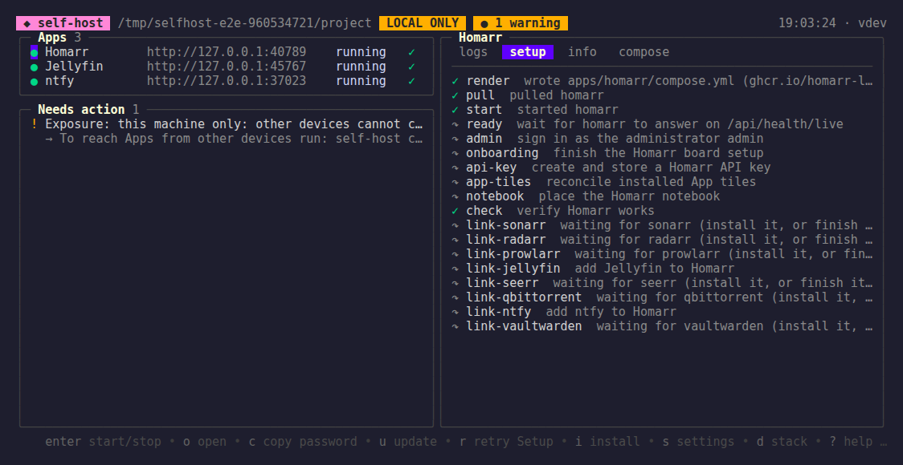

# self-host CLI

Run your own apps at home, like a movie server, without learning Docker.

**Using an AI assistant?** Paste this into it:

> Install the self-host skill from github.com/ajnart/selfhost-skills and help me run my own movie server.

**Using a terminal?** Two steps. Deploying needs Docker with the Compose v2
plugin. Linux, macOS, or Windows through WSL.

1. **Install the CLI** (it then offers to add the skill to your AI agent):

   ```bash
   curl -fsSL https://raw.githubusercontent.com/ajnart/selfhost-skills/main/install.sh | bash
   export PATH="$HOME/.local/bin:$PATH"
   ```

2. **Run `self-host`** for the terminal Dashboard.

The skill costs about 150 tokens while idle, and installing deploys nothing.
What anonymous usage data is collected:
[Telemetry](https://github.com/ajnart/selfhost-skills/wiki/Telemetry).

Choose an App. Review its ports and folders. Let `self-host` install it, create
its administrator account where supported, and connect it to the other Apps
in your Project. Come back to the Dashboard to open Apps, check health, retry
Setup, update images, or make a Backup.

One Go binary runs both the terminal interface and plain commands for agents.
Apps share one Docker Compose Project, normally in `~/.self-host`. The Catalog,
Setup code and agent guide ship inside the binary; running it needs no Node.js,
Bun, checkout, or AI account. A Project made by a pre-release build in
`~/self-host` is not picked up; `SELF_HOST_HOME=$HOME/self-host` points the CLI
at one.

Ask your agent to use the self-host skill ("use self-host to watch my movies on
the TV"; `/self-host` in Claude Code and OpenClaw, `$self-host` in Codex). Agents
also load the skill on their own when you talk about running your own apps.

If something fails:

- `self-host: command not found`: add `~/.local/bin` to `PATH`.
- The agent's guide has no New and Advanced paths: run `self-host self-update`.
- Docker missing or stopped: install or start it, then run `self-host doctor`.
- A 404 or authentication error: run `gh auth login`, then
  `gh api -H 'Accept: application/vnd.github.raw+json' repos/ajnart/selfhost-skills/contents/install.sh | SELF_HOST_GITHUB_TOKEN="$(gh auth token)" bash`.
- `curl` reports an error but the command seems to succeed: a pipe hides
  curl's exit status. In scripts run `set -o pipefail` first.
- Windows: use WSL; native Windows is unsupported.

**Release proof:** [self-host 0.1.2](https://github.com/ajnart/selfhost-skills/releases/tag/new-cli-v0.1.2)
is published. Linux amd64 host installation, self-update and a clean Alpine
bootstrap/update passed using the 0.1.2 installer; [release proof](docs/release-proof.md)
records the scope. The older npm CLI and agent-plugin releases use separate versions.



Actual 120×30 terminal session with an isolated, loopback-only Homarr/Jellyfin/ntfy
Project at `374bd1c`, captured after all nine Homarr API/browser stages passed.
[Activity steps](docs/images/workflow.png),
[Catalog search](docs/images/install-search.png), [terminal recording](docs/demos/self-host.cast)
(asciicast v2) and [capture provenance](docs/demos/capture.json) come from the same
real binary and fixture. This demonstrates these three Apps, not the full Catalog.

## Install details

The installer selects the highest stable CLI release (tags `vX.Y.Z`, or the
earlier `new-cli-vX.Y.Z`, carrying the `self-host_<version>_<os>_<arch>.tar.gz`
archives and `checksums.txt`), verifies the archive against `checksums.txt`, and
installs `self-host` in `~/.local/bin` (`/usr/local/bin` when run as root). When
that directory is not on `PATH` it prints the exact line to add for your shell
(bash, zsh or fish). `SELF_HOST_INSTALL_DIR` changes the destination;
`SELF_HOST_VERSION` accepts `X.Y.Z`, `vX.Y.Z` or `new-cli-vX.Y.Z`. Omit it to
select the highest stable CLI release. The script runs everything from one
`main` function on its last line, so a truncated download installs nothing.

`SELF_HOST_RELEASE_REPO=owner/name` makes the installer and `self-update` use
another repository (a fork, or the new name after a rename). The repository name
is written once in Go (`release.Repo`) and once in `install.sh` (`DEFAULT_REPO`);
GitHub redirects the old name after a rename, and both the installer and the
updater follow the redirect.

### A custom domain

The one-liner's URL is the only thing a domain changes. Point the domain at the
raw `install.sh` (a redirect or a proxy to
`https://raw.githubusercontent.com/<owner>/<repo>/main/install.sh` works);
the script, the updater and the releases stay where they are.

```bash
curl -fsSL https://your.domain/install.sh | bash
```

Check any URL with `scripts/verify-install.sh`: it runs the one-liner in
a throwaway `HOME`, then asserts `self-host --version` is the latest release,
`self-host skill` works, and a pinned old version upgrades through
`self-update`. While the repository is private, give it a token without printing
it: `SELF_HOST_GITHUB_TOKEN="$(gh auth token)" scripts/verify-install.sh`.
Once the repository is public, run it with no token. Set `VERIFY_INSTALL_URL`
to test a different URL, or a local script as `file:///path/to/install.sh`.

## Staying up to date

`self-host self-update` replaces the binary with the latest release after
checking its sha256 checksum. You do not have to remember it:

- **Dashboard:** when a newer release exists and nothing is running, bare
  `self-host` asks "self-host X is available (you have Y). Update now? y/n".
  `y` updates and restarts into the new version; `n` remembers that release in
  `<user cache dir>/self-host/update.json` (no secrets) so it does not ask
  again. The header and Settings → About keep showing that an update exists.
- **Plain commands:** on an interactive terminal, one line after the command,
  at most once every 24 hours, never delaying it.
- **Silence:** nothing appears under `--json`, off a terminal, with `CI` set, on
  a development build, or with `SELF_HOST_NO_UPDATE_CHECK=1`. Agents using
  `--json` are never interrupted.

Maintainers: [how to cut a release](docs/releasing.md).

When GitHub rejects an unauthenticated download, the installer accepts
`SELF_HOST_GITHUB_TOKEN` or, when unset, uses `gh auth token`. Never print or
paste a token into commands or reports.

To build the current development source from an authenticated checkout:

```bash
go build -buildvcs=false -o /tmp/self-host ./cmd/self-host
/tmp/self-host --help
```

Source builds require Go 1.26.0 or newer and access to Go module downloads.
Development builds cannot run `self-update`.

## Telemetry

self-host sends anonymous usage and error data to the project's PostHog
(through `hog.ajnart.dev`), so the project can see which Apps people install
and where Setup breaks. It is on by default, announced on first run (in
Onboarding, or in the first plain command), and the collected data is public:
**[public dashboard: link coming with #207](https://github.com/ajnart/selfhost-skills/issues/207)**.

- **Sent:** a random install ID (kept in `~/.self-host/telemetry-id`, never
  derived from your machine; delete the file for a new one), the self-host
  version, OS and architecture, command names and how long they took, whether
  they worked, App and Recipe IDs, the Access choice, failed step IDs, and
  errors as PostHog `$exception` events (error type and failed step only).
- **Never sent:** IP addresses or locations, host names, file paths, inputs,
  secrets, App data, or error text that could carry them. Events create no
  PostHog person profile and GeoIP is off.
- **Never in your way:** it is sent in the background and dropped if the
  network is slow.
- **Off:** set `SELF_HOST_NO_TELEMETRY=1` or `DO_NOT_TRACK=1`. It is always off
  when `CI` is set, in development builds and in tests. Nothing is sent before
  the notice was shown, so a `--json` command never sends first.

### Feedback

When something breaks that an agent cannot fix, it can send the maintainers a
report with `self-host feedback --message "…" [--app <id>]`. The CLI masks every
known secret, shows exactly what it will send, and asks you y/n first; the
message is at most 4096 bytes. It travels with Telemetry (same install ID, same
endpoint) and obeys the same off switches. With Telemetry off nothing is sent
and you are pointed to
[GitHub Issues](https://github.com/ajnart/selfhost-skills/issues).

## Easy names at home

Choose **Easy names at home** in Onboarding or Settings, under Access. Onboarding
selects it by default only when port 80 is available, Docker is not rootless,
and this computer can look up the names. Review still needs your approval.
For a new Project through the CLI, add `--easy-names` to `self-host install`;
for an existing one, after approval:

```bash
self-host config set EASY_NAMES=on
self-host status --json
```

One managed Caddy in the Compose Project serves HTTP names such as
`http://jellyfin.192-168-1-20.sslip.io`, on Linux and macOS. Each Catalog App
with a web page gets a route. Homarr tiles use the friendliest working Address.
The published `IP:port` Address is always kept. Turning names off with
`self-host config set EASY_NAMES=off` removes only the managed Caddy.

Names are offered as Addresses only while the Project's Caddy has a running
home-network port-80 binding and the stored LAN address is current. DNS success
alone is not App acceptance. After `down`, removing an App or retrying Setup
updates routes without starting Caddy; an explicit `start` starts Access too.
Stopped Apps defer their Access configuration until an approved start.

Access changes never silently reinstall Apps. If changing an origin would
replace a customized Paperless-ngx or Vaultwarden fragment, the command refuses
before changing settings or files. Keep your image pins, mounts and environment
overrides; update the origin manually or approve a reinstall separately. Restore
checks Access before replacing App data and rebuilds routes without rerunning Setup.

Names are **checked from this computer**, not your phone or TV. They need
internet name lookup; a router may hide them. Status explains blocked, offline
or rewritten lookups in plain words and keeps the numbered Addresses. Technical
details are in `status --json` under `names`. Port 80 conflicts, rootless Docker
and non-home network addresses are refused without changes.

The port check tries binding on IPv4 and IPv6. If Linux denies the port-80
inspection, names stay off even with rootful Docker: an unverified port is not
treated as free. Point-to-point and `/32` interfaces are not home networks.

Names contain the LAN address: when DHCP changes it, review Host settings with
`self-host config review`, then update bookmarks. A router DHCP reservation
avoids this. sslip.io sees the LAN address in name queries. HTTP is not encrypted
and does not satisfy Apps that require HTTPS, including Vaultwarden's web vault.
Do not forward port 80 on your router. No `.local` announcer or host socket is
installed; [Linux `.local` follow-up](https://github.com/ajnart/selfhost-skills/issues/232).

## Requirements and platforms

Deployment needs a working Docker engine, the `docker compose` v2 plugin with
Compose `include` support, write access to the Project and data folders, free
published ports, and sufficient storage/RAM for the selected Apps. Start with
one App; photo libraries, AI workloads and multi-App Recipes need more capacity.
Run `self-host doctor` before installation. With rootless Docker, compatible
images may require container `PUID=0 PGID=0`; host filesystem ownership remains
the invoking user. Images with fixed container UIDs need separate handling.

| Platform       | Binary target           | Current validation                                                               |
| -------------- | ----------------------- | -------------------------------------------------------------------------------- |
| Linux amd64    | Yes                     | Published host install/update and clean Alpine bootstrap/update passed.          |
| Linux arm64    | Yes                     | Native CLI/local archive checks passed; image support varies by App.             |
| macOS arm64    | Yes                     | Native CLI/local archive checks passed; deployment requires a Linux Docker VM.   |
| Intel macOS    | Yes                     | Native CLI execution, local checksummed install and corruption rejection passed. |
| WSL2           | Linux binary inside WSL | Planned path; native WSL validation pending.                                     |
| Native Windows | No                      | Unsupported.                                                                     |

[Source/native CI](https://github.com/ajnart/selfhost-skills/actions/runs/37662562771)
and [0.1.2 release packaging](https://github.com/ajnart/selfhost-skills/actions/runs/37663197041)
passed at `d908cb6`. All four native targets passed CLI execution, local
checksummed installation and corruption rejection. Published-asset install/update
proof covers Linux amd64; the other platforms and WSL remain unverified for that
path. Docker/App evidence is the separate Linux runtime matrix below.

## First App

```bash
self-host doctor
self-host apps info ntfy
self-host install ntfy --exposure local
self-host status
self-host
```

Interactive install reviews Host settings and the selection. The example uses
**this machine only** (`local`); the default is **local network** (`lan`),
which publishes ports on all host interfaces. Review network/firewall scope
before choosing LAN access. Public ingress is a separate decision.

To front the Apps with your own reverse proxy, run
`self-host access export --format caddy` (or `nginx`, `traefik`, `json`). It
prints each App's name, internal upstream (the Compose service and container
port, plus the host `IP:port` for a proxy outside Docker) and a hostname to
replace, with a note when an App needs WebSockets or long timeouts. It changes
nothing; Traefik output is a file provider, so no Docker socket is needed.
Unmanaged apps in `extra/` (or historical `apps/` folders) are included when
their Compose fragment identifies one literal published HTTP upstream: TCP
port 80, or a port marked `app_protocol: http`. Unknown WebSocket and timeout
requirements stay omitted. Ambiguous or unsupported fragments produce a
warning (`warnings` with `id` and `reason` in JSON, comments in snippets), not
a guessed upstream. Export never loads secret env files or Compose env files.

Run `self-host` on a terminal to open the first-install flow or the existing
Dashboard. Use `4` to open the Catalog and `/` to search. A Recipe chooses a
bundle: inspect `self-host apps list`, then install it by ID, for example
`self-host install media`. External accounts, hardware and browser-only setup
remain explicit prerequisites.

On a machine without a Project, `self-host` opens Onboarding. It checks Docker
and Docker Compose (a failed check shows its fix and `r` checks again;
warnings do not stop you), says that nothing is written until you approve the
plan, then asks one thing at a time and says why. **What** picks Recipes and
Apps and shows the highlighted item's description. Picking a Recipe picks its
Apps, which you can untick one by one, and its mark shows whether all, some or
none are picked; an App that needs answers
of its own asks them next. **Where** explains each field in a line while it is
focused: the LAN address, the Host settings and, only for media Apps, the
media and downloads folders. **Access** ("How you'll open your Apps") lists Home
network (the default), Easy names at home, From anywhere privately, Your own web
address and Bring your own, each with a plain explanation and a small diagram
that follow the highlighted option. `?` opens a longer help page that ends with
its technical details (`esc` or `?` closes it); in a text input `?` types a
question mark. Home network and Bring your own exist: the other options are
dimmed and marked coming soon, `enter` on one only says so, and nothing changes.
Bring your own is for advanced users with SWAG, Pangolin, Nginx Proxy Manager,
Traefik or their own Caddy; `enter` on it also changes nothing and points at
`self-host access export`. In Settings, the
Access sub-tab offers the same list; `enter` makes a choice pending and `ctrl+s`
applies it. **Who** sets the one Admin login for every App: a password
of your own, or leave it empty and self-host generates one, kept with the
Project and shown by `self-host credentials`; the password is always masked.
**Look** shows a sample of the Nerd Font icons and asks whether they look
right, then saves the choice as the appearance setting. **Review** lists the
plan; approving it plays the pre-boot screen while the first install pulls its
images, a parallax starfield with the overall bar, "N of M images" and a line
comparing the time left to something small, then hands over to the Dashboard
with Activity focused, where the install carries on. `enter` skips to Activity, `c` opens Ko-fi and `s` GitHub
Sponsors; a failed pull lands on Activity at once, and `NO_COLOR` keeps the
motion without colour. `esc` goes back one step and keeps your answers.

The Dashboard has five tabs: Overview, Apps, Activity, Catalog and Settings.
The header names the Project, its LAN address, the host's health and the
time; on a narrow terminal the Overview's Now strip says the LAN address and
time the header has no room for. The bar on the last row shows the global keys and the focused pane's
keys.

The Overview is the command center. The Now strip mirrors the running Action
(its bar or stages and one line on what happens now) and, once it ends, its
result next to the host's health. Below it, every App shows its Status,
category, address, state and Setup, and Needs attention lists failed and
Manual steps, stopped Apps, updates and host warnings, each with the chord
that resolves it, such as `a r` (retry Setup), or the command to run. `tab`
focuses Needs attention: `a` then opens the Action menu for that item's App
with its Action highlighted, and `enter` opens the App on the Apps tab.

| Dashboard key   | Action                                                                                                                                                                    |
| --------------- | ------------------------------------------------------------------------------------------------------------------------------------------------------------------------- |
| 1–5, ←/→        | Switch tabs.                                                                                                                                                              |
| ↑/↓ or k/j, tab | Move in the focused pane; move focus between panes.                                                                                                                       |
| [ and ]         | Switch the sub-tab: App details (logs, setup, info, compose, containers) or Settings (Host, Access, Appearance, Backups, Tools, About).                                   |
| a, A            | Open the Action menu for the selected App (or Needs attention item), or for the whole Project.                                                                            |
| enter, o, c     | Open the selected App in the Apps tab (there, focus its details); open its URL; choose a password or API key to copy.                                                     |
| /               | Search the focused list: the Overview's Apps pane, the Apps tab's list, Activity or the Catalog.                                                                          |
| ?, q            | Help; quit. On Onboarding's Access step and Settings' Access sub-tab, `?` opens the highlighted option's help page instead of the key reference (`esc` or `?` closes it). |

No single key changes an App or the Project. The Action menu lists only the
Actions valid now: Start or Stop, Restart, Update, Retry Setup, Backup and
Remove for an App; Up all, Down all, Restart all, Update all and Backup for
the Project. A letter highlights an Action and shows what it will do; `enter`
runs it, a second `enter` confirms Stop, Remove and Down all, and `esc`
closes the menu. With the mouse, a click highlights an Action and a click on
the highlighted one runs it, with the same second confirmation. Unavailable Actions stay greyed with the reason.

While a search or an edit takes text, every key goes to it; in the App list
`/` filters on name or id, `enter` keeps the filter and `esc` clears it. Settings has
five sub-tabs, switched with `[` and `]`: Host, Appearance, Backups, Tools and About.
Host applies edits with `ctrl+s`; `esc` returns to the Overview. Backups lists the
archives in `~/.self-host/backups` with date, size and whether each is encrypted:
`b` asks for an optional passphrase (typed as dots; empty means unencrypted, otherwise it
is asked twice) and backs up the whole Project, and `enter` on an archive opens a restore
preview that offers the whole Project or one App, asks for the passphrase only when the
archive is encrypted, and restores only once `enter` is pressed twice in the preview. Both
run as Actions in Activity, and no key deletes an archive. Tools finds `ctop` and
`lazydocker` on `PATH`: `enter` runs one and
the TUI resumes when it exits; a missing one is dimmed with its install command for this
platform and `c` copies it (self-host never installs a tool). About shows the version, the Project folder and whether a newer
release exists; `c` opens Ko-fi and `s` GitHub Sponsors in the browser. Appearance
chooses the icons: Nerd Font (needs a [Nerd Font](https://www.nerdfonts.com)
in the terminal) or Simple Unicode symbols, the default. The choice is saved at
once in the Project's `appearance.json`, and the CLI in a terminal uses it too.
Bars, spinners and state dots look the same in both. Activity takes focus when
an Action starts and plays it: its stages, each App's Setup steps one at a
time, credentials as masked dots, Links filling into arrows and one line that
says what is happening now. The finished Action stays until the next one;
below it are remembered render/pull/start, Setup, Links and checks. Space
expands an App, `/` filters, and enter expands a failed step's error and
recovery hint.
While an Action pulls images, Activity, the status line and the CLI in a
terminal show one overall bar, a slim bar per image and "N of M images"; piped
output keeps one `✓ pulled` line per image. In a terminal the CLI prints its
usual lines and draws the same Action below them; piped and `--json` output
stay plain.

The Apps tab holds everything about one App: the App list on the left and
App details on the right, including its containers and images with their
state, health, uptime, ports and update state. While the containers sub-tab
is open, each running container also shows CPU (of the whole machine) and
memory (of its limit, or the machine's memory) bars with the MiB in use.
`r` there reloads the containers and checks for updates again.
Down removes the Project's containers and networks while keeping volumes,
App files and Setup records. Use named volumes or bind mounts for persistent
data: anonymous volumes are not automatically reattached after Down/Up.
The equivalent commands are `self-host up`, `self-host down` and
`self-host restart`.

## Agents and automation

Run `self-host skill` to get the guide matching the installed binary.
The repository's one public skill, `skills/self-host/SKILL.md`, is the
agent entry point and routes to that guide.

Inspect first, agree on the Apps and Access, then apply the approved selection:

```bash
self-host doctor --json
self-host apps list --json
self-host apps info ntfy --json
# After approval:
self-host install ntfy --exposure local --yes --json
self-host status --json
```

Use repeated `--set app.key=value` for documented non-secret inputs and
`--set app.port=N` to select a port. `--media-root`, `--downloads-root` and
`--exposure lan|local` set new-Project choices; `--admin-user` defaults to
`admin`. An Admin password is generated unless `SELF_HOST_ADMIN_PASSWORD` is
provided through the environment. Forgejo uses `selfhost-admin` for a fresh
install when the shared username is `admin`; check its App credentials for the
actual login. Do not pass secrets as command arguments.

Private fields use `--set-file app.key=/owned/mode-0600/path`, for example
`--set-file gluetun.openvpn-password=/owned/private/openvpn-password` for an
already-provided credential file. The file must be owned by the Project owner
and mode 0600. Private values are saved only in the Project's `secrets.env`;
interactive private fields are masked. Provider accounts, VPN credentials,
existing tunnel enrollment and software licenses remain prerequisites. The CLI
does not create provider accounts or establish those external approvals for you.

With `--json`, mutations and `doctor` produce newline-delimited events;
`status`, `profile`, `apps list`, `apps info` and `credentials` produce JSON documents.
Read each `step.fail` and its hint. Exit codes are `0` for success, `1` for an
error and `2` for incomplete Setup. A failed Setup needs repair and
`self-host setup <app>`; completed steps are skipped. Verify the App's intended
function afterward. A running container or HTTP 200 alone is not acceptance.

`self-host credentials` deliberately reveals the Shared Admin login and per-App API
keys. Use it privately; exclude its output, logs, passwords and API keys from
chat replies, screenshots and ordinary evidence.

## Daily commands

| Command                             | Effect                                                                        |
| ----------------------------------- | ----------------------------------------------------------------------------- |
| `status [--updates]`                | Show URLs, container state, health and Setup; optionally check image updates. |
| `setup [app...]`                    | Retry unfinished Setup.                                                       |
| `start`, `stop`, `restart [app...]` | Operate named Apps, or every installed App when omitted.                      |
| `update [app...]`                   | Pull images, recreate Apps and rerun checks.                                  |
| `logs <app> [--follow] [--tail N]`  | Read container logs; default tail is 200 lines.                               |
| `remove <app>... [--yes]`           | Remove Apps while keeping data; `--purge` also deletes their data folders.    |
| `config set KEY=value...`           | Change Host settings and recreate affected Apps.                              |
| `config review [--yes]`             | Review current host drift; `--yes` applies detected LAN IP/time zone fixes.   |
| `self-update`                       | Replace a release binary with the latest stable checksummed CLI release.      |

Prefix each with `self-host`. `--verbose` (`-v`) adds command and step details.
Use `--yes` for approved noninteractive install, remove and restore operations;
it is authorization to perform the operation, not a preview flag.

For an isolated Project, set both `SELF_HOST_HOME` to an absolute directory and
`SELF_HOST_COMPOSE_PROJECT` to a unique lowercase Compose name. Keep them
consistent for subsequent commands. Do not point this CLI at an older CLI's
Project as an assumed migration path.

Current source rejects duplicate Compose service names across App fragments
before apply. When older installed fragments shared a cache service name,
reinstall both affected Apps to regenerate their separate cache definitions.
This is not an automatic data migration: old Redis containers/data are not
retired without established ownership and approval.

## Cannot reach an App from another device

For one broken App, `self-host debug <app>` (or `--json`) prints its state,
failed steps with hints, the last 100 log lines with secrets masked, and its
health-check URL. Start with `self-host status` and `self-host doctor`. Check the recorded
Access and URL, Docker availability, published ports, and the host firewall.
`local` binds to loopback. To deliberately allow LAN access:

```bash
self-host config set EXPOSURE=lan
```

After moving networks, `status --json` reports `lan_ip_stale` when the saved
address is gone. Repair it with `self-host config set LAN_IP=auto`, or review
all Host settings using `self-host config review`. These operations recreate
Apps that use changed settings. `config review --yes` applies detected LAN IP
and time zone fixes; ownership IDs and folder changes remain deliberate choices.

If the URL works on the host but fails on your phone/TV, check same-network
connectivity, guest-network isolation, firewall scope and Docker VM forwarding.
A host-side probe cannot prove reachability from that device.

## Backup and Restore

```bash
self-host backup --encrypt
self-host backup ntfy --encrypt --output /absolute/private/ntfy.tar.zst.age
self-host restore /absolute/private/ntfy.tar.zst.age ntfy
```

Provide `SELF_HOST_BACKUP_PASSPHRASE` through your credential provider, or answer
the interactive prompt. Keep the passphrase separately from the archive.
Backup pauses running App services while copying their folders, then starts
those services again. It includes App folders, Host settings, state and secrets;
external media/download libraries and data stored outside App folders are not
included. Even a single-App Backup contains Project credential metadata.

The default destination is `~/.self-host/backups/selfhost-DATE.tar.zst`, with
`.age` added for encryption. Restore replaces the selected Apps' current data
and asks for confirmation; `--yes` skips it. A fresh Project requires a full
Backup restore before selective restores are possible. Review Host settings on
a different machine and verify logins, data and the App's actual workload.

Keep another private copy off the host. A written archive is not a verified
recovery plan: perform a restore into an isolated Project and check the data.
Generic acceptance checks archive extraction and Setup/Check. Selected Apps
also seed and recover real API/database payloads; those probes establish only
the workload they exercise. Check the per-target evidence for recovery coverage.

## What is supported

The Catalog contains **93 Apps and 20 Recipes** (19 legacy Recipes plus
`media`). The final [runtime matrix](docs/runtime-matrix.md) and
[JSON evidence](docs/runtime-matrix.json) record **97 passes, 3 failures,
8 awaiting external credentials and 5 manual** across all 113 targets.
Each result belongs to its recorded head, binary, image IDs and platform;
these mixed-head passes do not verify every App on the current binary.

BookStack, Speedtest Tracker and Passbolt failed on this host.
[PHP-FPM confinement evidence](docs/php-fpm-host-limit.md) documents the host
access limits; Passbolt's HTTP 500 is not fully explained by that reproduction.
Have the host administrator review PHP-FPM bootstrap/configuration access before
retrying Setup.
External credentials/licenses remain owner-supplied. Dockge, Emby, Stalwart,
Uptime Kuma and the monitoring Recipe need manual setup.

Homarr has [real API/browser and visual proof](docs/homarr-proof.md): nine
machine checks, owned cleanup and reviewed dashboard/panel screenshots passed
at one immutable head. The terminal screenshots above use that same fixture
and binary. API payload checks, archive sentinels, browser review and full
workload recovery remain distinct claims.

| Capability         | Available behavior                                                                         | Evidence limit                                                                                 |
| ------------------ | ------------------------------------------------------------------------------------------ | ---------------------------------------------------------------------------------------------- |
| Catalog install    | Compiled Compose definitions and App inputs.                                               | All-catalog runtime acceptance is incomplete.                                                  |
| Setup and Links    | Per-App API/configuration routines; retry unfinished steps.                                | Browser-only tasks, external credentials and remote enrollment may need you.                   |
| Dashboard/Activity | TUI, persisted stages, retry hints and live progress.                                      | Actual three-App terminal capture above; full-Catalog/browser visuals remain separate.         |
| Lifecycle/update   | Project-scoped commands and image refreshes.                                               | Update checks do not establish safe version-to-version migration.                              |
| Backup/Restore     | Compressed archives, optional encryption, selected-App restore.                            | API/database payload probes apply only where recorded; sentinels establish archive extraction. |
| Unmanaged Apps     | Lifecycle/Backup for Compose App folders added by hand under `~/.self-host/extra/<name>/`. | No compiled Setup for off-Catalog Apps; see `self-host skill`.                                 |
| VPN/public access  | App configuration where implemented.                                                       | Tunnel-break fail-closed, DNS/TLS and external accounts need their own proof.                  |

[Acceptance documentation](e2e/acceptance.md) defines lifecycle stages,
per-target outcomes and the limits of generic checks. Manual, blocked,
missing-configuration, awaiting-external-credentials and not-run targets are
reported separately from passes. External provider enrollment, VPN fail-closed,
version-to-version migration and full workload recovery require their own proof.
