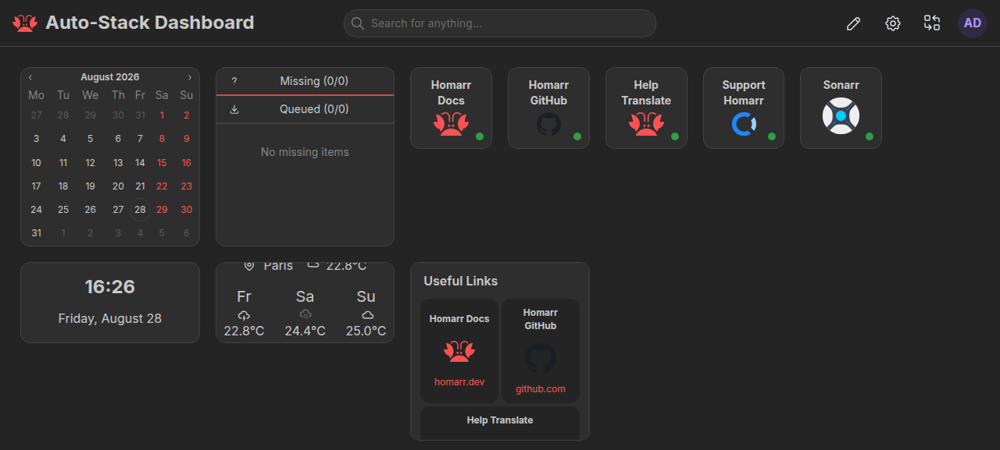

# Selfhost Skills

**Replace subscriptions with private services, keep your data on hardware you
control, and decide exactly who can reach it.**

`selfhost-skills` gives popular coding agents a conversational, safety-gated
way to plan and operate self-hosted software. Ask for an outcome such as “my
own Netflix,” “replace Google Photos,” or “back up this server.” The agent turns
that goal into a reviewable stack without treating the request as permission
to change your host.

Not every subscription has a practical self-hosted replacement. The catalog
explains tradeoffs and keeps the final choice yours.

## Tell it what you want to replace

You don't need to know the software names. Start with a familiar service:

```text
/self-host I want to replace Google Photos and Google Drive
/self-host Netflix
/self-host password manager
/self-host Google Drive, Microsoft OneDrive, Dropbox
/self-host smart speaker
/self-host audio books and music
```

| Your goal | Suggested apps | What they do |
| --- | --- | --- |
| Photos and cloud storage | **Immich + Nextcloud** | Back up and browse photos; sync and share files. |
| Your own movie library | **Jellyfin** | Watch movies and shows you own on your TV, phone or browser. |
| Music and audiobooks | **Navidrome + Audiobookshelf** | Stream your own music and audiobook collection, plus podcasts. |
| A private password manager | **Vaultwarden** | Use compatible Bitwarden apps; set up HTTPS and recovery before importing passwords. |
| Household budgeting | **Actual Budget** or **Firefly III** | Track budgets, accounts and spending. |
| Smart-home control, optional voice and cameras | **Home Assistant**, optionally **Scrypted** | Connect compatible devices, automations and camera systems. |
| Files, office work or notes | **Nextcloud**, with tools chosen for your needs | Share files and add document collaboration when needed; evaluate local note apps separately. |

Every stack includes **Homarr**, a nice dashboard to open your self-hosted
apps and see useful information from connected services. Setup checks the
available integrations and widgets; a shortcut alone isn't a tested integration.
Moving existing data and setting up a separate backup are planned before switching.
We currently use `ghcr.io/homarr-labs/homarr-test:v2`.

Caddy is an optional way to give apps friendly HTTPS addresses. Setup reuses an
existing proxy where possible and keeps access private unless you choose
otherwise. Network access settings determine who can reach the apps; HTTPS
protects traffic; each app still needs appropriate login and
access controls. Voice assistants need suitable hardware, and media apps need
your own content: these apps don't include a Netflix or Spotify subscription
catalog. Savings depend on the subscriptions you can cancel and the cost of
hardware, hosting, electricity and backups.

The agent explains these choices briefly, then guides setup. See the
[service selection guide](.agents/skills/self-host/references/choosing-services.md)
for the replacement boundaries. Catalog coverage remains broader than the
seven-service tested media harness; other setups retain their stated guided
or discovery status until verified.

## Install and choose your stack

Before running it, install Git and Bun 1.4.0 or newer, including `bunx`.

Start the interactive installer from the project that will own the stack:

```bash
bunx --bun skills@latest add ajnart/selfhost-skills
```

For the simplest install, use the complete-pack command below. After
installation, use **Self-host · Start here**; the other entries are supporting
capabilities the agent reads when needed. For a selective install, keep the
complete `basic` profile and add the packs you want. The required `basic` profile is the public entry, setup, upkeep, planning,
host inspection, Compose, operations, Homarr, and verification. The `media`
pack adds the exact seven-service workflow. Backup, ingress, observability, research,
and downloader VPN are independent extensions. Setup checks this dependency
closure and installs anything you missed.

To install the complete pack globally into the checked common-agent set:

```bash
bunx --bun skills@latest add ajnart/selfhost-skills --skill '*' --agent codex --agent claude-code --agent kiro-cli --agent pi --agent roo --agent windsurf --global --copy --yes
```

`--global` makes the selection available outside one project. `--copy` gives
each distinct client directory a complete standalone copy. Codex is the single
installer target for the universal `.agents/skills` directory also read by Amp,
Cline, Cursor, Gemini CLI, GitHub Copilot, and OpenCode; repeating those flags
would only rewrite the same target. The common set therefore covers Amp, Claude
Code, Cline, Codex, Cursor, Gemini CLI, GitHub Copilot, Kiro CLI, OpenCode, Pi,
Roo Code, and Windsurf. Use the interactive installer to target any other agent
supported by the current CLI.

The versioned release ZIP is an [Agent Plugins 1.0](https://agent-plugins.org/specification)
package: root `plugin.json`, flat immediate children under `skills/`, and a
`.claude-plugin/` compatibility manifest for Claude Code. Every `SKILL.md`
in that portable package follows the
[Agent Skills specification](https://agentskills.io/specification).
The source checkout remains canonical under `.agents/skills/`; the release
projection avoids committing a second editable skill tree.

See the generated [skill index](SKILL_INDEX.md) for risk, activation, and
compatibility metadata. Never put a token in an install command, clone URL,
prompt, shell history, or a checked-in file.

From a source checkout, inspect the same checked profiles through the Bun
TypeScript CLI:

```bash
bun run stack profiles
```

## Your first conversation

Use one command for planning, setup, and later maintenance:

| Client | Start here |
| --- | --- |
| Codex | `$self-host media` |
| Claude Code | `/self-host media` |
| Pi | `/skill:self-host media` |
| Other supported agents | Select **Self-host · Start here** and pass `media` |
| Existing stack | Run the same command from its project directory |
| Plan only | Ask to plan without applying, or use ordinary language |

The skill keeps the conversation short. It asks only for choices that affect
the result:

- what you want to run, replace, protect, or reach;
- which host should own it and whether existing services may be reused;
- whether you want access only at home or also from your phone while away;
- your username policy, when the selected apply capability supports one;
- whether that capability should generate credentials or resolve an existing
  secret reference; and
- whether you want optional pieces such as backups or monitoring; Homarr is
  included as the standard access layer.

Say “use the defaults” to accept the recommended stack, private access, one
bounded Compose project, and generated credentials where implemented. An
unsupported credential choice becomes a visible blocker instead of a promise.
Homarr is included by default. Public exposure,
destructive work, migrations, and secret entry still require an explicit
decision.

For example:

```text
You:    $self-host photos
Agent:  I can plan Immich with Homarr as its private front door on this host.
        Should I use the recommended credential policy and services, or do
        you want to change them?
You:    Use the defaults.
Agent:  I’ll inspect the host read-only and show you the plan before changes.
```

Do not paste an existing password or API key into chat. The setup agent resolves
or generates values only at the narrow apply boundary. For the managed media
pack, it asks for your username and generates the password. When you request
saved credentials, it gives you the path to an owner-only private access file.

## Homarr: the default front door

[Homarr](https://homarr.dev) is the standard control plane for every stack. It
provides one dashboard for apps and widgets plus one private MCP endpoint for
read-only agent inspection. The underlying services still operate
independently, and Homarr never grants authority over another service or makes
anything public.

Use `$selfhost homarr` in Codex or `/selfhost homarr` in Claude Code for a
standalone Homarr plan. Other goals include it automatically. Direct administration for Sonarr, Radarr, Prowlarr,
and qBittorrent can remain private even when approved users reach Homarr or
Jellyfin remotely.



_Illustrative, redacted screenshot from the repository harness. It shows the
kind of dashboard Homarr can provide; it is not evidence that a current
deployment or every integration is verified._

## How it works


1. **Resolve the selected profile.** `$self-host` routes setup to the supporting workflow, which checks the required
   Base, Pack, and Extension skills without mutating browser state. Through the
   normal approval flow it installs missing selected skills plus the official
   `agent-browser` skill, CLI, and browser, then runs the gated browser check.
2. **Understand the goal.** The router turns a purpose into a small set of
   service choices and offers recommended defaults.
3. **Inspect read-only.** `selfhost-host` checks the platform, Docker context,
   ports, paths, disks, networks, and bounded existing resources it can see.
4. **Build a plan.** The selected capabilities describe reuse, conflicts,
   paths, exposure, secrets, backups, acceptance, and rollback without secret
   values.
5. **Ask for approval.** The agent shows the exact project and operations.
   Material choices remain visible instead of being hidden behind defaults.
6. **Apply narrowly.** Only the owning capability may change its explicitly
   identified Compose project or configuration boundary.
7. **Verify independently.** Evidence is checked against the selected stack's
   acceptance contract. A running process or HTTP 200 is not broad success.
8. **Record and hand back.** Private `.selfhost/stack.json` records the profile,
   owned services, explicit extension-to-service bindings, adapter pointers,
   and typed checkpoint evidence for upkeep. The final summary links the
   redacted report and any explicitly requested private credential export.

Every run follows the same lifecycle:

```text
select -> inspect -> plan -> approval -> apply -> verify -> handoff
```

Planning is a valid stopping point. If the host cannot be inspected, a secret
is unavailable, or evidence is weak, the workflow reports that limit instead
of inventing certainty.

## Common goals and stacks

| Ask for | Common choices | Purpose |
| --- | --- | --- |
| “My own Netflix” | Jellyfin, Seerr, Sonarr, Radarr | Play an authorized library and organize requests |
| “Replace Google Photos” | Immich | Back up, browse, search, and share photos |
| “Replace Dropbox or Drive” | Nextcloud, Syncthing | Store files or synchronize them between devices |
| “Scan and search documents” | Paperless-ngx, Stirling PDF | OCR an archive and perform private PDF work |
| “Host my password vault” | Vaultwarden | Run an encrypted vault with deliberate recovery |
| “Automate my home” | Home Assistant, Frigate | Connect local automations and camera events |
| “Reach it from my phone” | Tailscale, Headscale, Caddy, Pangolin | Add private or separately approved public access |
| “Back up this server” | Restic, BorgBackup, Kopia | Protect configuration, data, and databases off-host |
| “Monitor my services” | Uptime Kuma, Gatus, Beszel | Observe health and route actionable alerts |
| “Run AI locally” | Ollama, Open WebUI | Serve supported models behind a private interface |

The validated catalog contains 111 applications across 20 goal stacks for
media, photos, documents, files, passwords, home automation, networking,
monitoring, backups, containers, developer tools, productivity, databases,
storage, and local AI.

A bare `vpn` stays ambiguous because remote access and downloader-only VPN
routing solve different problems. The skill asks which purpose you mean.

## Resume an existing project

Return to the same project directory and invoke `$self-host` or `/self-host`.
It detects the recorded stack and reads confirmed intent and lifecycle state from:

```text
.selfhost/preferences.json
.selfhost/project.json
.selfhost/stack.json
```

`preferences.json` remembers choices such as paths, locale, exposure, and
backup policy. `project.json` remembers the goal, selected services, plan
fingerprint, and planning checkpoint. `stack.json` records selected profiles,
installed skills, owned services, explicit consuming-profile bindings, runtime
and connection-file pointers, and typed lifecycle evidence. The first write
creates `.selfhost/.gitignore`;
these records contain neither raw host inventory nor secret values.

Upkeep re-inspects the real host, then resumes, extends, updates, repairs, or
re-verifies the exact recorded stack. Saved context explains intent; it does
not prove that containers, ports, disks, networks, or proxies remain healthy.

## Credential handoff

The conversation may collect a username and credential policy only when the
selected apply capability implements it. Secret values stay out of prompts,
plans, logs, screenshots, fixtures, and client configuration.

For the seven-service media harness, one mode-`0600` `connections.env` retains
local URLs, usernames, and available API keys so later extensions can wire
services without rediscovery. It never stores the initial admin password.
When you request saved credentials, `handoff` writes
`.sessions/<run>/artifacts/private-handoff.json` with owner-only permissions
(0600): generated password, usernames, available API keys, service URLs and
storage paths. The separate `handoff-report.md` contains no credentials. The
agent returns file paths without printing private contents. An export can
contain partial setup state and does not prove verification passed. The stack
record stores only the connection-file path and its non-secret schema.

## Safe by default

- Inspection and planning are read-only. Apply requires approval for the exact
  project, paths, exposure, and operation.
- Local, LAN, or private-tailnet access is the default. Public access needs a
  separate plan with one owner for DNS, TLS, ports 80/443, and authentication.
- One Compose project is the mutation boundary. The pack never runs a
  host-wide Docker teardown, prunes volumes, or casually mounts the Docker
  socket.
- Existing containers, networks, paths, and proxies are reused only after
  ownership and lifecycle are known.
- Downloader VPN safety requires a recorded tunnel-break test that proves
  traffic fails closed.
- Backup verification requires an isolated restore. A backup file on the same
  disk is not independent recovery.
- The media stack supports only legally obtained, owned, public-domain, or
  otherwise authorized content.

## Composable architecture


The repository is intentionally Markdown-led. Markdown defines the
conversation, workflows, safety gates, references, and completion criteria.
Declarative JSON holds catalog facts and stack choices. Small scripts perform
bounded deterministic work such as inspection, rendering, validation,
verification, and debugging; they do not become a second policy layer.

`self-host` is the public lifecycle entry point. It discloses the supporting
planning, setup, or upkeep workflow as needed. Together they compose only the
capabilities needed for the selected profile and goal:

| Skill | Boundary it owns |
| --- | --- |
| `self-host` | Public command that routes planning, setup, and upkeep |
| `selfhost-setup` | Supporting prerequisites, setup, stack metadata, and final access handoff |
| `selfhost-upkeep` | Resume, extension, upgrade, repair, and re-verification of a recorded stack |
| `selfhost` | Goal routing, catalog choices, preferences, and a redacted plan |
| `selfhost-host` | Read-only host discovery and path advice |
| `selfhost-compose` | One explicitly owned Docker Compose project |
| `selfhost-ingress` | LAN, tailnet, reverse proxy, DNS, TLS, and tunnels |
| `selfhost-vpn` | Downloader-only VPN isolation and fail-closed evidence |
| `selfhost-backup` | Backup policy and isolated restore proof |
| `selfhost-observe` | Health, logs, metrics, alerts, and edge checks |
| `selfhost-operations` | Upgrades, migrations, rollback, and troubleshooting |
| `selfhost-research` | Current official deployment and lifecycle evidence |
| `selfhost-verify` | Independent, secret-free acceptance aggregation |
| `selfhost-media` | Opt-in Homarr-enhanced media harness |
| `selfhost-homarr` | Default dashboard, integrations, API, and read-only MCP |

The checked registry contains 15 packaged skills, including 2 specialized adapters:
the stack-scoped `selfhost-media` and application-scoped `selfhost-homarr`.
Capabilities remain separate so a photo setup does not inherit media,
downloader, or public-network authority.

### Repository map

```text
.agents/
├── skills/self-host/             # Public lifecycle entry point
├── skills/selfhost/              # Router, catalog, stack selection
├── skills/selfhost-setup/        # Explicit new-stack lifecycle
├── skills/selfhost-upkeep/       # Explicit continuation lifecycle
├── skills/selfhost-*/            # One operational boundary per capability
├── CONTEXT.md                    # Shared product and safety vocabulary
├── invocation.md                 # Composition and resume contract
└── install.md                    # Distribution contract
docs/                             # Human service notes and diagrams
prompts/                          # Segmented media workflow stages
scripts/                          # Focused validation and debugging tools
PROMPT.md                         # Canonical media-harness entry point
docker-compose.yml                # Canonical media-harness Compose source
README.md                         # Human entry point
```

The exact package registry is
`.agents/skills/selfhost/references/catalog/skills.json`. Installed skills
carry their own `scripts/`, `references/`, and `assets/`, so runtime behavior
does not depend on arbitrary files in this repository.

## Media and Homarr boundary

The managed owned-content adapter connects Seerr, Jellyfin, Sonarr, Radarr,
Prowlarr, qBittorrent, and the required Homarr control plane. Invoke
`$selfhost-media` in Codex or `/selfhost-media` in Claude Code only when you
want that exact seven-service harness.

The harness binds service ports to loopback by default. For a headless host,
the access plan distinguishes the browser's address, Homarr's internal service
addresses, and links the user can actually open. An explicitly selected host
bind or private proxy route can make Homarr reachable from approved devices;
public exposure requires its own ingress plan.

Homarr must use exactly:

```text
ghcr.io/homarr-labs/homarr-test:v2
```

Homarr app tiles, integrations, and widgets are separate acceptance claims.
Its API key stays in a private profile, and the local bridge injects it only at
runtime. The default client fragment remains strictly read-only. It can inspect
integrations and search Seerr, then show the exact match and ask for
confirmation, but it cannot submit a request or modify an app.

A separate policy-enabled profile can expose authenticated
`integration_request` calls for explicitly approved integration IDs, service
kinds, HTTP methods, and exact paths. It does not enable arbitrary requests;
`integration_requestMedia`, `app_update`, `mediaRequests_answerRequest`
remain unavailable. See the
[integration-request policy](.agents/skills/selfhost-homarr/references/api-and-mcp.md#integration-request-policy).
Keep Homarr's native `/api/mcp` private; a public dashboard route must deny that
path while the packaged bridge reaches it over loopback, LAN, or a private tailnet.

## Installation options

For a non-interactive project-local install of the complete pack:

```bash
bunx --bun skills@latest add ajnart/selfhost-skills --skill '*' --agent codex --agent claude-code --agent kiro-cli --agent pi --agent roo --agent windsurf --yes
```

List available skills without installing:

```bash
bunx --bun skills@latest add ajnart/selfhost-skills --list
```

For a smaller install, replace `--skill '*'` with a named selection such as
`--skill selfhost-setup`, repeat it for the desired profile, and keep only the
intended `--agent` targets. The setup prerequisite gate resolves and offers to
install every missing required sibling before apply.

The checked IDs and project/global target directories live in
[`coding-agents.json`](.agents/skills/selfhost-setup/references/coding-agents.json).

`--all` is deliberately broader: it selects every skill for every agent target
supported by the CLI. Use it only when that fan-out is intentional. See
[the installation contract](.agents/install.md) for exact Base, Pack,
Extension, global, project-local, copy, and selective-install behavior.

## Requirements

- **Git and Bun:** Git plus Bun 1.4.0 or newer for installation. Verify `git`,
  `bun`, and `bunx`, then
  install from the public repository without embedding credentials in URLs.
- **Docker:** Docker Engine or Docker Desktop with Docker Compose v2 for stacks
  that use Compose. Confirm the intended Docker context before any apply.
- **Storage:** enough suitable storage for the selected workload, plus a
  distinct backup target when recovery matters.
- **Browser evidence:** setup installs the official `agent-browser` skill, Bun
  CLI package, and Chrome for Testing when they are absent. Its first
  prerequisite pass is non-mutating; after approval, `--verify-browser` may
  clean stale agent-browser daemon sidecars through the official doctor.
  Browser-backed checks use an isolated named session and never disable
  Chromium's sandbox automatically.
- **Platform-specific dependencies:** follow the official source selected by
  `selfhost-research`; discovery never implies permission to install them.

## Validate this repository

The repository maintenance gate runs on Bun 1.4.0 or newer:

```bash
bun scripts/skillpack.ts validate --scope all
bun scripts/skillpack.ts validate --scope all --json
```

It checks skill metadata, references, catalog semantics, required siblings,
the Homarr image, bundled-media drift, prohibited runtime material, and
Bun TypeScript/Bash syntax. It does not use Docker, a browser, or the network.

The explicit installer smoke test is separate:

```bash
bash scripts/smoke-install.sh
```

The smoke check requires Bun 1.4.0 or newer. It resolves the installer through
`bunx --bun` and uses disposable projects to verify default symlink, explicit
copy, and selected-profile layouts. It does not change a real client or global
configuration.

## Troubleshooting

- **Repository not found:** confirm the repository and requested release or
  branch exist; keep credentials out of commands and URLs.
- **A required skill is missing:** install the full pack or the exact siblings
  returned by `$selfhost-setup` or `$selfhost-upkeep` prerequisite checks.
- **The skill works only inside the source repo:** reinstall with both
  `--global` and `--copy`, then start a new client session.
- **An existing project does not resume:** invoke `$selfhost-upkeep` from the
  directory that owns `.selfhost/stack.json`.
- **Host facts are unavailable:** grant only the narrow read access needed, or
  leave those facts unknown.
- **Catalog facts are stale:** refresh official lifecycle, image, and
  deployment evidence before apply.
- **Media bundle drift:** update the canonical harness through its owning
  workflow and regenerate the bundle. Do not patch the generated copy.
- **Browser checks are blocked:** fix the prerequisite or report the UI as
  unverified.

## More detail

- [Invocation and composition](.agents/invocation.md)
- [Installation contract](.agents/install.md)
- [Shared concepts and safety model](.agents/CONTEXT.md)
- [Catalog design](.agents/skills/selfhost/references/catalog.md)
- [First-party skills repository research](research/skills-repo-patterns.md)
- [Media harness guide](docs/README.md)
- [Contribution and release rules](CONTRIBUTING.md)

Affiliate relationships, if added later, must be disclosed beside the link and
cannot influence rankings or defaults. Product names, trademarks, upstream
licenses, hosted-service terms, and media rights remain with their respective
owners.
