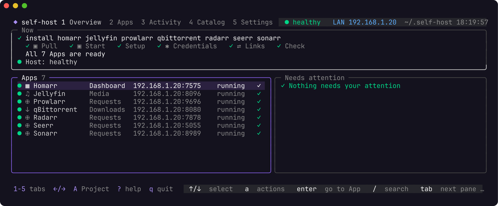

<p align="center">
  <picture>
    <source media="(prefers-color-scheme: dark)" srcset="docs/assets/brand/mark/mark-dark.svg">
    <source media="(prefers-color-scheme: light)" srcset="docs/assets/brand/mark/mark-light.svg">
    
  </picture>
</p>

<h1 align="center">self-host</h1>

<p align="center"><b>Try self-hosted apps from your terminal.</b></p>

<p align="center">
  <a href="https://github.com/ajnart/self-host/releases/latest"></a>
  <a href="LICENSE"></a>
  
  <a href="https://self-host.fyi/apps"></a>
</p>

<p align="center">
  <a href="https://self-host.fyi">Website</a> · <a href="https://self-host.fyi/docs">Docs</a> · <a href="https://self-host.fyi/#reel">Showreel</a> · <a href="https://discord.gg/aCsmEV5RgA">Discord</a>
</p>

self-host is a terminal UI for getting self-hosted Apps running with Docker Compose. Pick an App, let it set up an account and connect the Apps it supports, then try it.

It's meant for people getting started, or anyone who wants to try an App before adding it to their own setup. Think of it as a small terminal-based alternative to Portainer, with App setup included.

**If you already have a setup you're happy with, you don't need this.** It manages its own Compose Project, not your existing containers.

## Get started

You need Docker with a Compose v2 plugin that supports `include`. See [Platforms and support](#platforms-and-support) for tested Linux, macOS and WSL2 setups.

```bash
curl -fsSL https://self-host.fyi/install | bash
```

That installs only the binary, not any Apps. Run `self-host`, pick what you want to try and review the plan before anything gets installed.

<p align="center"></p>

<details>
<summary><b>Other ways to install</b> (wget, Homebrew, Docker, packages, Arch, archive, source)</summary>

Every channel installs the same release binary, byte for byte.

| Channel               | Command                                                                                                                                                      |
| --------------------- | ------------------------------------------------------------------------------------------------------------------------------------------------------------ |
| wget                  | `wget -qO- https://self-host.fyi/install \| bash`                                                                                                            |
| Homebrew (macOS)      | `brew install ajnart/tap/self-host`                                                                                                                          |
| Docker                | `docker run --rm -it ghcr.io/ajnart/self-host:latest` plus socket and Home folder mounts: [full command](https://self-host.fyi/docs/getting-started#install) |
| Debian, Ubuntu (.deb) | `sudo apt install ./self-host_X.Y.Z_linux_amd64.deb`                                                                                                         |
| Fedora, RHEL (.rpm)   | `sudo dnf install ./self-host_X.Y.Z_linux_amd64.rpm`                                                                                                         |
| Alpine (.apk)         | `sudo apk add --allow-untrusted ./self-host_X.Y.Z_linux_amd64.apk`                                                                                           |
| Arch Linux, Omarchy   | `sudo pacman -U ./self-host_X.Y.Z_linux_amd64.pkg.tar.zst`                                                                                                   |
| Release archive       | `self-host_<version>_<os>_<arch>.tar.gz` from [Releases](https://github.com/ajnart/self-host/releases), then check it against `checksums.txt`                |
| Go                    | `go install github.com/ajnart/self-host/cmd/self-host@latest`                                                                                                |
| From source           | `git clone https://github.com/ajnart/self-host && cd self-host && go build -buildvcs=false -o ~/.local/bin/self-host ./cmd/self-host`                        |

Packages come from [GitHub Releases](https://github.com/ajnart/self-host/releases/latest) for `amd64` or `arm64`. Go and source builds need Go 1.26.0+ and cannot `self-update`.

Update with `self-host self-update` for the script and the archive. Homebrew, Docker and packages update through their own tool.

</details>

To read the install script first: `curl -fsSL https://self-host.fyi/install -o install.sh`, compare `shasum -a 256 install.sh` with `https://self-host.fyi/install.sh.sha256`, then `bash install.sh`. It verifies the archive against `checksums.txt` and installs to `~/.local/bin`. Version, folder and fork options are in the [docs](https://self-host.fyi/docs/getting-started#install).

## Try an App

Say a friend recommends Immich. You want to try it with a few photos before deciding whether to add it to your home server. Pick it in the Dashboard, or run:

```bash
self-host install immich
```

Your account is created for you. `self-host credentials` shows your login, and `self-host status` shows where to open the App.

If it isn't for you, run `self-host remove immich`. That removes its containers but keeps its data. Deleting the data is a separate choice with `--purge`.

If you like it, keep running it here or set it up yourself with Docker Compose. You can try the App before deciding how much time you want to spend on your setup.

Browse the 93 Apps in the [Catalog](https://self-host.fyi/apps). See [Platforms and support](#platforms-and-support) for what has been verified.

## What gets set up

The main thing this adds to Docker Compose is App-specific setup. For example, `self-host install media homarr` installs a media setup and a dashboard, then connects the supported Apps:

- Sonarr and Radarr get qBittorrent as their download client.
- Seerr connects to Jellyfin, Sonarr and Radarr.
- Homarr gets tiles for the Apps it supports.

Passwords are generated by default. Some Apps still need a manual step, which the Dashboard shows. You still need to provide your own media and configure any indexers or content sources.

You can do all of this with Docker Compose yourself. self-host automates the setup so you can try using the Apps first.

The Compose files and App configuration live in `~/.self-host`. You can read the files it writes. It uses Docker Compose to run the containers, not a separate container engine.

> [!IMPORTANT]
> Nothing installs without your approval. Onboarding writes nothing until you approve its plan, and no single Dashboard key changes an App.

> [!NOTE]
> Apps are third-party software under their own licences. self-host installs and connects them; it does not own or maintain them.

<details>
<summary><b>Details and limits</b></summary>

| ✅ Does                                                                         | ❌ Doesn't                                                                      |
| ------------------------------------------------------------------------------- | ------------------------------------------------------------------------------- |
| Ships the Catalog inside the binary: 93 Apps and 7 Recipes.                     | Install Docker for you. `self-host doctor` checks it.                           |
| Sets up accounts, API keys and settings where supported.                        | Change another Project's Compose files or App configuration.                    |
| Wires Apps together with Links, and gives Homarr native tiles.                  | Back up media libraries or data outside App folders.                            |
| Shows a five-tab Dashboard (Overview, Apps, Activity, Catalog, Settings).       | Run on native Windows. Use WSL2.                                                |
| Offers Access from the Home network to Tailscale, Cloudflare or your own proxy. | Ship indexers, trackers or content sources.                                     |
| Backs up and restores with optional encryption.                                 | Prove safe version-to-version migration. Update checks are not migration tests. |
| Gives agents plain commands with `--json` output.                               | Make every App work: one is hidden ([details](#platforms-and-support)).         |

A **Recipe** is a pre-wired bundle: `media` is qBittorrent, Sonarr, Radarr, Prowlarr, Jellyfin and Seerr.

</details>

## With an agent

Paste this into Claude Code, Codex, OpenCode, OpenClaw or any coding agent:

```text
Use https://self-host.fyi/llms.txt to help me set up my own home server. Ask what I want to run, explain the plan, and wait for my approval before installing.
```

Or write the shared skill and dedicated folders for supported agents installed on the machine:

```bash
self-host skill install
```

Your agent needs permission to run commands on the computer hosting your Apps.
See [With an agent](https://self-host.fyi/docs/agents), including the OpenClaw section.

<details>
<summary><b>Agent reference</b></summary>

The one public skill, [`skills/self-host/SKILL.md`](skills/self-host/SKILL.md), only routes to the guide built into the binary. Print it with `self-host skill`. Agents also read <https://self-host.fyi/llms.txt>.

Agents follow **inspect → plan → approval → apply → verify**. Loading the skill is intent, never approval: every change needs the person's explicit yes.

```bash
self-host doctor --json
self-host apps list --json
# only after the person approves:
self-host install ntfy --exposure local --yes --json
self-host status --json
```

- Pass secrets with `--set-file app.key=/path`, never as arguments. They land only in the Project's `secrets.env`.
- Exit codes: `0` success, `1` error, `2` incomplete Setup, `3` only Manual steps remain.
- A running container or HTTP 200 is not acceptance. Check that the App does its job.

All flags, events and the isolated Project setup are in the [agent docs](https://self-host.fyi/docs/agents).

</details>

## Reaching your Apps

Home network by default. Each change needs your approval.

**Anything reachable from the internet needs its own explicit yes that names the risk.** Do not forward port 80 on your router for Easy names.

<details>
<summary><b>Access options</b></summary>

| Access                   | What you get                                                                         | Status                                                                                                                                                                                                                        |
| ------------------------ | ------------------------------------------------------------------------------------ | ----------------------------------------------------------------------------------------------------------------------------------------------------------------------------------------------------------------------------- |
| Home network (default)   | `http://192.168.1.20:8096`. Ports publish on all host interfaces.                    | Verified 2026-10-14 on Linux ([#499](https://github.com/ajnart/self-host/issues/499)) and 2026-10-17 on macOS with OrbStack ([#502](https://github.com/ajnart/self-host/issues/502)). Another device was not tried on macOS.  |
| This computer only       | `127.0.0.1` (`--exposure local`).                                                    | Verified 2026-10-26 on WSL2, opened from Windows through localhost forwarding ([#502](https://github.com/ajnart/self-host/issues/502)).                                                                                       |
| Easy names at home       | `http://jellyfin.192-168-1-20.sslip.io`, through one managed Caddy.                  | Verified 2026-10-14 on Linux with rootless Docker, from a second machine ([#500](https://github.com/ajnart/self-host/issues/500)). Not yet verified on macOS ([#502](https://github.com/ajnart/self-host/issues/502)).        |
| From anywhere, privately | Tailscale, one HTTPS node per App.                                                   | Verified 2026-10-26 from another tailnet device, with the fix in v0.6.3 ([#502](https://github.com/ajnart/self-host/issues/502)).                                                                                             |
| Your own web address     | Cloudflare Tunnel plus a login page.                                                 | Verified 2026-10-26 with a real domain: from outside, the App answered with the Cloudflare login page, and `self-host cloudflare remove` took it down again (v0.6.2, [#502](https://github.com/ajnart/self-host/issues/502)). |
| Bring your own           | `self-host access export` for SWAG, Pangolin, Nginx Proxy Manager, Traefik or Caddy. | Not yet verified on a real host.                                                                                                                                                                                              |

The `IP:port` Address is always kept as a fallback.

Cannot reach an App from another device? Run `self-host debug <app>`, then see [Access](https://self-host.fyi/docs/access) and [Troubleshooting](https://self-host.fyi/docs/troubleshooting).

</details>

## Backup and Restore

> [!NOTE]
> Backups include App folders, Host settings, state and secrets, so keep the archive and its passphrase apart. Media libraries and data outside App folders are not included.

<details>
<summary><b>Backup details</b></summary>

A written archive is not a verified recovery plan: restore into an isolated Project and check the data.

```bash
self-host backup --encrypt
self-host restore <archive> [app]
```

</details>

## Commands

Everything the Dashboard does is also a plain command.

<details>
<summary><b>All commands</b></summary>

Prefix with `self-host`. `--verbose` (`-v`) adds detail. `--yes` authorizes an approved noninteractive install, remove or restore; it is not a preview flag.

| Command                                              | What it does                                                                              |
| ---------------------------------------------------- | ----------------------------------------------------------------------------------------- |
| `doctor`                                             | Check Docker, Compose and the Host, and a Project's Apps and ports.                       |
| `host report [--extra]`                              | Report OS, Docker access and port binds. Changes nothing.                                 |
| `install <app\|recipe>...`                           | Install Apps or Recipes into the Project.                                                 |
| `status [--updates]`                                 | URLs, container state, health and Setup; optionally check image updates.                  |
| `setup [app...]`                                     | Retry unfinished Setup.                                                                   |
| `up`, `down`                                         | Start / remove the Project's containers and networks. `down` keeps volumes and App files. |
| `start`, `stop`, `restart [app...]`                  | Operate named Apps, or every installed App when omitted.                                  |
| `update [app...]`                                    | Pull images, recreate Apps and rerun checks.                                              |
| `logs <app> [--follow] [--tail N]`                   | Container logs; default tail is 200 lines.                                                |
| `remove <app>... [--yes]`                            | Remove Apps, keep data; `--purge` also deletes their data folders.                        |
| `config set KEY=value...`                            | Change Host settings and recreate affected Apps.                                          |
| `config review [--yes]`                              | Review Host drift; `--yes` applies detected LAN address and time zone fixes.              |
| `access export --format caddy\|nginx\|traefik\|json` | Print each App's upstream for your own reverse proxy. Changes nothing.                    |
| `backup`, `restore`                                  | See [Backup and Restore](#backup-and-restore).                                            |
| `debug <app>`                                        | Status, failed steps with hints and the last 100 log lines, secrets masked.               |
| `apps list`, `apps info <app>`                       | Browse the Catalog.                                                                       |
| `apps request <name> [--url URL]`                    | For agents: report an App the Catalog lacks.                                              |
| `feedback [-m text] [--app app]`                     | Send a report to the maintainers after you see the masked text and agree.                 |
| `credentials`                                        | Print the Admin login and per-App API keys.                                               |
| `share`                                              | Print a postable install line and site link for the Apps you run.                         |
| `profile`, `profile set experience`                  | Show or change what self-host remembers about you, such as your Experience level.         |
| `skill`, `skill install\|remove`                     | Print the agent guide; make the skill discoverable by your agents, or remove it.          |
| `cloudflare plan\|publish\|remove`                   | Publish Apps on your domain behind a login; `plan` previews.                              |
| `self-update`                                        | Replace the binary with the latest checksummed release.                                   |

A Compose folder you add by hand under `~/.self-host/extra/<name>/` is an Unmanaged app: it gets lifecycle, Address listing and Backup, but no Setup.

</details>

## App connections

These connections are called Links. They run when both Apps have finished their own Setup.

<details>
<summary><b>Which Apps link to which</b></summary>

A **Link** connects one App to another. It belongs to the App using the connection, such as Sonarr using qBittorrent as a download client.

| Consumer       | Linked to                                         |
| -------------- | ------------------------------------------------- |
| Sonarr, Radarr | qBittorrent (download client)                     |
| Prowlarr       | Sonarr, Radarr                                    |
| Seerr          | Jellyfin, Sonarr, Radarr                          |
| Cleanuparr     | Sonarr, Radarr, qBittorrent                       |
| Homarr         | native tiles and widgets for the Apps it supports |

A failing Link marks the consuming App as needing attention, not its target. Browser-only steps are reported as **Manual steps** with a hint and stay retryable: `self-host setup <app>`. Homarr Links need Homarr **2.4.1** or newer; NZBGet and SABnzbd Links need **2.5.1** or newer. Other versions stop with a recovery hint (back up first). See the [Homarr contracts](docs/homarr-integration-contract.md) and [proof](docs/homarr-proof.md).

</details>

## Platforms and support

<details>
<summary><b>Requirements, validated platforms and the runtime matrix</b></summary>

You need Docker with the `docker compose` v2 plugin (with `include` support), write access to the Project and data folders, free published ports, and enough storage and RAM for the Apps. Start with one App; photos, AI and multi-App Recipes need more. Run `self-host doctor` first.

Each status below is a dated launch run on a real host or VM, linked to its issue. Nothing else counts.

| Platform                     | Status                          | Run                                                                                                                                                                                                                                                   |
| ---------------------------- | ------------------------------- | ----------------------------------------------------------------------------------------------------------------------------------------------------------------------------------------------------------------------------------------------------- |
| Linux amd64                  | Verified 2026-10-14             | Ubuntu 24.04, Debian 12 and 13 VMs. Install and `self-update` ([#497](https://github.com/ajnart/self-host/issues/497)); Onboarding, the Media Recipe with Homarr, Links, Backup and Restore ([#499](https://github.com/ajnart/self-host/issues/499)). |
| Linux amd64, Docker denied   | Verified 2026-10-14             | `sudo "$(command -v self-host)"` installs the Media Recipe and the Project stays yours ([#498](https://github.com/ajnart/self-host/issues/498)).                                                                                                      |
| Linux amd64, rootless Docker | Verified 2026-10-14             | Debian 13: a Recipe installs, and Easy names open from a second machine ([#500](https://github.com/ajnart/self-host/issues/500)).                                                                                                                     |
| Linux arm64                  | Verified 2026-10-14             | Debian 12 VM: install and one Recipe ([#501](https://github.com/ajnart/self-host/issues/501)).                                                                                                                                                        |
| macOS arm64 with OrbStack    | Verified 2026-10-17             | v0.5.11, Photos and cloud files Recipe, Home network Access ([#502](https://github.com/ajnart/self-host/issues/502)).                                                                                                                                 |
| macOS with Docker Desktop    | Not yet verified on a real host | Not run ([#502](https://github.com/ajnart/self-host/issues/502)).                                                                                                                                                                                     |
| Intel macOS                  | Not yet verified on a real host | Not run ([#502](https://github.com/ajnart/self-host/issues/502)).                                                                                                                                                                                     |
| WSL2                         | Verified 2026-10-26             | v0.6.2 on Windows Server 2025 with WSL2 (Ubuntu 24.04, Docker Engine): Photos and cloud files Recipe, This computer only Access, opened from Windows ([#502](https://github.com/ajnart/self-host/issues/502)).                                        |
| Native Windows               | Unsupported                     | Not supported.                                                                                                                                                                                                                                        |

Known issues from these runs, both fixed in v0.6.0: a newcomer saw Nextcloud's Homarr credential-recovery inputs and Review listed port 7575 ([#589](https://github.com/ajnart/self-host/issues/589)); removing the last App left its network and `down` refused ([#590](https://github.com/ajnart/self-host/issues/590)).

One App, Passbolt ([#456](https://github.com/ajnart/self-host/issues/456)), is hidden from new installs until it passes on a VM. BookStack, LLDAP and Speedtest Tracker passed a VM run on 2026-10-25 and are offered again. Existing installs keep working ([#493](https://github.com/ajnart/self-host/issues/493)). Apps beyond those in the runs above have no launch run, so the older [runtime matrix](docs/runtime-matrix.md), a 2026-10-07 snapshot, is a pre-launch record, not a promise.

Docker socket denied? Run `sudo "$(command -v self-host)"`. The Project, config and cache stay yours. Rootless Docker also works.

</details>

## Troubleshooting

<details>
<summary><b>Common fixes</b></summary>

| Symptom                                       | Fix                                                                         |
| --------------------------------------------- | --------------------------------------------------------------------------- |
| `self-host: command not found`                | Add `~/.local/bin` to `PATH`.                                               |
| Docker missing or stopped                     | Install or start it, then `self-host doctor`.                               |
| 403 rate limit on install                     | `SELF_HOST_GITHUB_TOKEN="$(gh auth token)"` before `bash`, or wait an hour. |
| `curl` error but the command seems to succeed | A pipe hides curl's exit status; use `set -o pipefail` in scripts.          |
| Native Windows                                | Unsupported. Use WSL2.                                                      |

More in the [troubleshooting docs](https://self-host.fyi/docs/troubleshooting).

</details>

## Responsible use

> [!WARNING]
> self-host installs and connects software; what you do with it is your responsibility. Download clients, indexers and media automation have legitimate uses: Linux ISOs, public-domain and Creative Commons works, and media you own or are licensed to copy. **We do not condone piracy and do not help anyone find or download content they have no right to.** self-host ships no indexers, trackers or content sources. Follow copyright law where you live and the terms of every service you connect.

The software is provided as is, without warranty (Apache-2.0). The maintainers are not liable for how it is used.

## Telemetry

Anonymous, on by default, and easy to turn off.

<details>
<summary><b>What is sent, what is not, and how to turn it off</b></summary>

| Sent                                                                           | Never sent                                 |
| ------------------------------------------------------------------------------ | ------------------------------------------ |
| A summary when you approve Onboarding's plan (your choices, not your data).    | Your machine's host names or file paths.   |
| Errors: which command failed, which step, and where in the code.               | Secrets, App data or raw error text.       |
| The name and homepage host of an App an agent asks for that the Catalog lacks. | IP addresses or locations.                 |
| Feedback you wrote, only after you see the text and agree.                     | An ID that identifies you or your machine. |

Nothing is stored to link one run to another. The maintainers use it to see which Apps people install and where Setup breaks. It is never sold or shared.

To turn it off, set `SELF_HOST_NO_TELEMETRY=1` or `DO_NOT_TRACK=1` (or `true`). The full list is on the [telemetry page](https://self-host.fyi/telemetry).

</details>

## Docker Compose Maker

Want Compose files without using the CLI? [Docker Compose Maker](https://self-host.fyi/compose) (DCM) turns the Apps you pick into a `docker-compose.yaml` and `.env`, with a Template gallery. [self-host.fyi/apps](https://self-host.fyi/apps) lists every App in the Catalog with the same compose self-host installs, and [self-host.fyi/compose](https://self-host.fyi/compose) adds containers only DCM defines. It lives in [`dcm/`](dcm/) and also runs standalone: `docker run -p 7576:7576 ghcr.io/ajnart/dcm`.

## Repository layout

| Path                | What it is                                                |
| ------------------- | --------------------------------------------------------- |
| `cmd/`, `internal/` | The Go binary: CLI, Dashboard, the Catalog and every App. |
| `site/`             | The Astro site at self-host.fyi.                          |
| `dcm/`              | Docker Compose Maker, served at self-host.fyi/compose.    |
| `tools/sitegen`     | Writes the site's and DCM's data from the Catalog.        |
| `docs/`             | Decisions, agent briefs, release notes and proofs.        |

`site/` and `dcm/` are one bun workspace: run `bun install` at the root. See [`CONTRIBUTING.md`](CONTRIBUTING.md).

## Community and support

- [Star the repo](https://github.com/ajnart/self-host/stargazers) if you found it useful.
- [Discord](https://discord.gg/aCsmEV5RgA): questions and show and tell.
- [GitHub Issues](https://github.com/ajnart/self-host/issues): bugs and App requests.
- Support the work: [GitHub Sponsors](https://github.com/sponsors/ajnart) · [Ko-fi](https://ko-fi.com/ajnart).
- Contributing: read [`CONTRIBUTING.md`](CONTRIBUTING.md) and [`CONTEXT.md`](CONTEXT.md), open an issue first, then send a pull request.
- New to self-hosting? [awesome-selfhosted](https://github.com/awesome-selfhosted/awesome-selfhosted).
