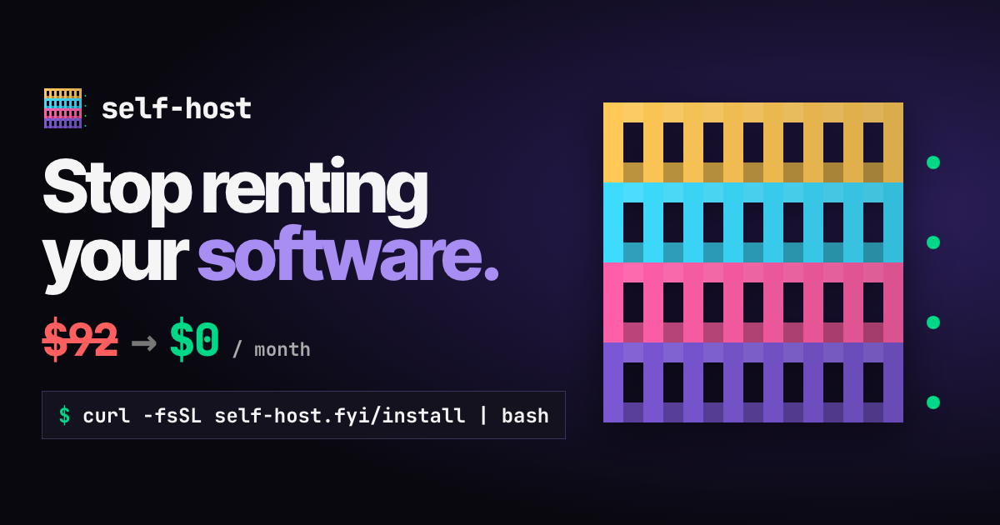
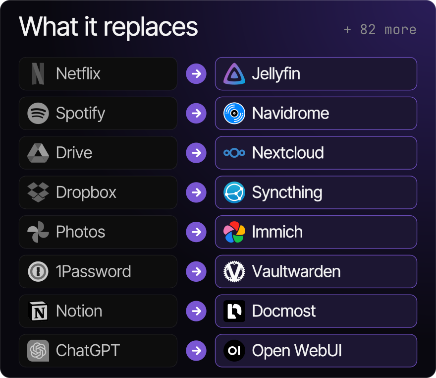

<picture>
  <source media="(prefers-color-scheme: dark)" srcset="docs/assets/logo-dark.svg">
  <source media="(prefers-color-scheme: light)" srcset="docs/assets/logo-light.svg">
  
</picture>

# self-host

**Run your own apps at home without learning Docker.** One Go binary installs, wires together and operates self-hosted Apps with Docker Compose: a terminal Dashboard for people, plain commands for agents.

[Website](https://self-host.fyi) · [Try it in the browser](https://self-host.fyi/#play) · [Discord](https://discord.gg/aCsmEV5RgA) · [Agent docs](https://self-host.fyi/llms.txt)

[](https://self-host.fyi/#reel)

## What it replaces

<p align="center"></p>

Netflix, Spotify, Drive, Dropbox, Photos, 1Password, Notion and ChatGPT each have an App you can run yourself, and every App in the picture is in the Catalog and installs today, for example `self-host install immich`. Each one runs on your own machine through Docker Compose, with Setup done for you. Browse the rest in the [Catalog](https://self-host.fyi/apps) or with `self-host apps list`.

## 30 seconds setup

<p align="center"></p>

Needs Docker with the Compose v2 plugin. Linux, macOS, or Windows through WSL.

```bash
curl -fsSL https://self-host.fyi/install | bash
# or: wget -qO- https://self-host.fyi/install | bash
export PATH="$HOME/.local/bin:$PATH"
self-host doctor
```

That installs the binary and deploys nothing. Then preview and install a Recipe, and open the Dashboard:

```bash
self-host install media homarr
self-host
```


<details>
<summary><b>What happens next</b> (Onboarding, Dashboard, Catalog)</summary>

On a machine with no Project, bare `self-host` opens Onboarding: it checks Docker, then checks Home-folder disk space and the selected Apps' ports at Review. It asks one thing at a time and writes nothing until you approve the plan. The Dashboard has five tabs: Overview, Apps, Activity, Catalog, Settings. `?` lists the keys. No single key changes an App; the Action menu (`a`) shows what each Action will do and runs it on `enter`. On start it asks once about a changed network, stopped Apps or App updates, and `y` fixes it.

The Catalog ships inside the binary: **90 Apps, 7 Recipes**. A Recipe is a pre-wired bundle (`media` is qBittorrent, Sonarr, Radarr, Prowlarr, Jellyfin, Seerr). Browse with `self-host apps list` and `self-host apps info <app>`. No Node.js, checkout or AI account needed. Apps share one Compose Project in `~/.self-host` (move it with `SELF_HOST_HOME`). Only download media you own or have the right to: see [Responsible use](#responsible-use).

The screenshot is a real 120×30 session of a loopback-only Homarr/Jellyfin/ntfy Project: [Activity](docs/images/workflow.png), [Catalog search](docs/images/install-search.png), [recording](docs/demos/self-host.cast), [provenance](docs/demos/capture.json).

</details>

## With an agent

Paste this into Claude Code, Codex, OpenCode, OpenClaw or any coding agent:

```text
Install the self-host skill from github.com/ajnart/self-host and help me run my own movie server.
```

Or write the skill for every agent on the machine (Claude Code, Codex, OpenCode, Pi, Gemini, Hermes, `~/.agents`):

```bash
self-host skill install
```

<details>
<summary><b>Agent reference</b> (guide, JSON commands, flags, exit codes)</summary>

The installer offers the same step when it finishes. The one public skill, [`skills/self-host/SKILL.md`](skills/self-host/SKILL.md), only routes to the guide built into the binary; it costs about 150 tokens while idle and installing it deploys nothing. Invoke it with `/self-host` in Claude Code and OpenClaw, `$self-host` in Codex.

```bash
self-host skill        # prints the guide that matches the installed binary
```

Agents: read <https://self-host.fyi/llms.txt>, then follow **inspect → plan → approval → apply → verify**. Loading the skill is intent, never approval; every change needs the person's explicit yes.

```bash
self-host doctor --json
self-host apps list --json
self-host apps info ntfy --json
# only after approval:
self-host install ntfy --exposure local --yes --json
self-host status --json
```

- `--set app.key=value` (repeatable) for non-secret inputs; `--set app.port=N` picks a port.
- `--set-file app.key=/path` for secrets: owner-only, mode 0600, `=-` reads stdin. Never pass secrets as arguments. Values land only in the Project's `secrets.env`.
- `--media-root`, `--downloads-root`, `--exposure lan|local`, `--easy-names`, `--admin-user` (default `admin`) set new-Project choices. The Admin password is generated unless `SELF_HOST_ADMIN_PASSWORD` is in the environment.
- With `--json`, mutations and `doctor` emit newline-delimited events; `status`, `profile`, `apps list`, `apps info`, `credentials` and `host report` emit JSON documents. Existing keys are stable; new fields are additive.
- Exit codes: `0` success, `1` error, `2` incomplete Setup. Read each `step.fail` and its hint, repair, then `self-host setup <app>` (completed steps are skipped).
- **A running container or HTTP 200 is not acceptance.** Verify the App does its job.
- `self-host credentials` reveals the shared Admin login and per-App API keys. Use it privately; keep output out of chat, logs and screenshots.
- `self-host debug <app>` prints Status, failed steps with hints, the last 100 log lines with secrets masked, and the health-check URL.

Isolated Project: set `SELF_HOST_HOME` (absolute path) and a unique lowercase `SELF_HOST_COMPOSE_PROJECT`, and keep both for later commands. Do not point this CLI at an older CLI's Project.

</details>

<p align="center"></p>

## Install

The `curl` one-liner in [30 seconds setup](#30-seconds-setup) is the recommended way. It picks the highest stable release, verifies the archive against `checksums.txt`, and installs to `~/.local/bin` (`/usr/local/bin` as root). It prints the exact `PATH` line for bash, zsh or fish when needed. A truncated download installs nothing.

Every other method below installs the same release binary, byte for byte.

<details>
<summary><b>Homebrew</b> (macOS and Linux)</summary>

```bash
brew install ajnart/tap/self-host
```

Update with `brew upgrade self-host`.

</details>

<details>
<summary><b>Docker</b> (nothing installed on the host)</summary>

The image holds the binary, the Docker CLI and the Compose plugin. It drives your host's Docker through the socket, which is the same trust as running self-host yourself. Mount the Home folder at the same path, because Compose resolves folders on the host.

```bash
# Linux
docker run --rm -it --network host \
  --user "$(id -u):$(id -g)" --group-add "$(stat -c %g /var/run/docker.sock)" \
  -v /var/run/docker.sock:/var/run/docker.sock \
  -v "$HOME/.self-host:$HOME/.self-host" \
  -e USER -e HOME -e SELF_HOST_HOME="$HOME/.self-host" \
  ghcr.io/ajnart/self-host:latest

# macOS (OrbStack or Docker Desktop): the container cannot see your LAN address, so pass it
docker run --rm -it \
  --user "$(id -u):$(id -g)" --group-add 0 \
  -v /var/run/docker.sock:/var/run/docker.sock \
  -v "$HOME/.self-host:$HOME/.self-host" \
  -e USER -e HOME -e SELF_HOST_HOME="$HOME/.self-host" \
  -e SELF_HOST_LAN_IP="$(ipconfig getifaddr en0)" \
  ghcr.io/ajnart/self-host:latest
```

No arguments opens the Dashboard; add any command (`doctor`, `install jellyfin`, `status`) after the image name. Update with `docker pull ghcr.io/ajnart/self-host:latest`.

</details>

<details>
<summary><b>Debian, Ubuntu, Fedora, Alpine</b> (.deb, .rpm, .apk)</summary>

Download the package for your architecture (`amd64` or `arm64`) from [GitHub Releases](https://github.com/ajnart/self-host/releases/latest):

```bash
sudo apt install ./self-host_X.Y.Z_linux_amd64.deb                    # Debian, Ubuntu
sudo dnf install ./self-host_X.Y.Z_linux_amd64.rpm                    # Fedora, RHEL
sudo apk add --allow-untrusted ./self-host_X.Y.Z_linux_amd64.apk      # Alpine
```

They install `/usr/bin/self-host` and recommend Docker. Update by installing the newer package.

</details>

<details>
<summary><b>Arch Linux and Omarchy</b></summary>

```bash
sudo pacman -U ./self-host_X.Y.Z_linux_amd64.pkg.tar.zst   # from GitHub Releases
```

Or build it the way the AUR would, from the `PKGBUILD` attached to each release:

```bash
curl -fsSLO https://github.com/ajnart/self-host/releases/latest/download/PKGBUILD
makepkg -si
```

`self-host-bin` is not on the AUR yet: AUR account registration is closed for now. It will be published there as soon as it reopens.

On Omarchy, Docker needs `sudo` by default (your user is not in the `docker` group). Either run `sudo self-host` (the Project stays yours) or turn on sudoless Docker with `omarchy-setup-security-sudoless-docker` and reboot. Omarchy also enables `ufw` with incoming traffic denied; if another device cannot reach an App, allow its port with `sudo ufw allow <port>/tcp`.

</details>

<details>
<summary><b>Release archive</b> (manual download)</summary>

Pick `self-host_<version>_<os>_<arch>.tar.gz` for `linux` or `darwin`, `amd64` or `arm64` from [GitHub Releases](https://github.com/ajnart/self-host/releases).

```bash
VERSION=X.Y.Z   # set to the latest release (no leading v): https://github.com/ajnart/self-host/releases/latest
OS=linux        # or darwin
ARCH=amd64      # or arm64
BASE=https://github.com/ajnart/self-host/releases/download/v$VERSION
ARCHIVE=self-host_${VERSION}_${OS}_${ARCH}.tar.gz

curl -fsSLO $BASE/$ARCHIVE
curl -fsSLO $BASE/checksums.txt
sha256sum -c --ignore-missing checksums.txt        # Linux
# grep " $ARCHIVE\$" checksums.txt | shasum -a 256 -c -   # macOS

tar -xzf $ARCHIVE self-host
mkdir -p ~/.local/bin && mv self-host ~/.local/bin/
```

Do not run the binary if the checksum check fails.

</details>

<details>
<summary><b>Install script options</b> (version, folder, read it first)</summary>

| Variable                 | Effect                                                                                  |
| ------------------------ | --------------------------------------------------------------------------------------- |
| `SELF_HOST_VERSION`      | Install `X.Y.Z` or `vX.Y.Z` instead of the latest.                                      |
| `SELF_HOST_INSTALL_DIR`  | Install here instead of the default directory.                                          |
| `SELF_HOST_RELEASE_REPO` | `owner/name` that publishes releases; also used by `self-update`. For forks.            |
| `SELF_HOST_GITHUB_TOKEN` | Lifts GitHub's anonymous API rate limit; falls back to `gh auth token`. Never paste it. |

Read it before you run it, and check the published hash:

```bash
curl -fsSL https://self-host.fyi/install -o install.sh
curl -fsSL https://self-host.fyi/install.sh.sha256   # compare with: shasum -a 256 install.sh
less install.sh && bash install.sh
```

</details>

<details>
<summary><b>Go / from source</b></summary>

Needs Go 1.26.0+.

```bash
go install github.com/ajnart/self-host/cmd/self-host@latest
# or
git clone https://github.com/ajnart/self-host && cd self-host
go build -buildvcs=false -o ~/.local/bin/self-host ./cmd/self-host
```

Development builds cannot `self-update`.

</details>

<details>
<summary><b>Updating</b></summary>

```bash
self-host self-update
```

For the install script and the release archive. Homebrew, the Docker image and system packages are updated by their own package manager, and `self-update` says so. It replaces the binary after checking its sha256. The Dashboard asks "Update now? y/n" once when idle (`n` is remembered per release in `<user cache dir>/self-host/update.json`); plain commands print one line at most every 24 hours. Silent under `--json`, off a terminal, with `CI` set, on development builds, or with `SELF_HOST_NO_UPDATE_CHECK=1`.

Verify any install URL with `scripts/verify-install.sh` (throwaway `HOME`; checks the version, `self-host skill` and an upgrade through `self-update`; `VERIFY_INSTALL_URL` overrides the URL). Maintainers: [how to cut a release](docs/releasing.md), [site deployment and release gates](docs/releasing.md#installer-site).

</details>

## Reaching your Apps (Access)

Home network by default. Easy names, Tailscale, Cloudflare or your own reverse proxy when you want them; each change needs your approval.

<details>
<summary><b>Access modes and how to set them up</b></summary>

Access decides each App's Address. Choose it in Onboarding or Settings → Access. **Review always needs your approval.**

| Access                   | What you get                                                                                  |
| ------------------------ | --------------------------------------------------------------------------------------------- |
| Home network (default)   | `http://192.168.1.20:8096`. Ports publish on all host interfaces: review firewall scope.      |
| This computer only       | `127.0.0.1` (`--exposure local`).                                                             |
| Easy names at home       | `http://jellyfin.192-168-1-20.sslip.io` through one managed Caddy.                            |
| From anywhere, privately | Tailscale, one HTTPS node per App.                                                            |
| Your own web address     | Cloudflare Tunnel plus a login page.                                                          |
| Bring your own           | `self-host access export` for SWAG, Pangolin, Nginx Proxy Manager, Traefik or your own Caddy. |

The `IP:port` Address is always kept as a fallback. Status and Homarr tiles prefer Tailscale HTTPS, then verified Cloudflare HTTPS, then working Easy names, then `IP:port`. Anything reachable from the internet needs its own explicit yes that names the risk.

### Easy names at home

Enable with `self-host install ... --easy-names` (new Project) or, after approval, `self-host config set EASY_NAMES=on`; turn off with `EASY_NAMES=off` (removes only the managed Caddy). Check with `self-host status --json` (`names`).

- Needs an active private home-network IPv4 address, free port 80 and rootful Docker. IPv6 and the CLAT service-continuity prefix are not supported. A port that cannot be verified is treated as busy. Conflicts are refused without changes.
- Names are **checked from this computer**, not your phone or TV; a router may hide them. DNS success is not App acceptance.
- The name embeds the LAN address: after a DHCP change run `self-host config review` and update bookmarks. A router DHCP reservation avoids this. sslip.io sees the LAN address in name queries.
- HTTP only: Apps that require HTTPS (Vaultwarden's web vault) won't work. **Do not forward port 80 on your router.** No `.local` announcer is installed ([#232](https://github.com/ajnart/self-host/issues/232)).
- Failed or interrupted Caddy updates keep names pending and numbered Addresses first until an approved retry. `down` cancels pending startup. Access changes never silently reinstall Apps: if an origin change would replace a customized Paperless-ngx or Vaultwarden fragment, the command refuses first.

### From anywhere, privately (Tailscale)

Install Tailscale on your devices and sign in to the same account. On the [DNS page](https://login.tailscale.com/admin/dns) enable HTTPS with MagicDNS on. **App names appear in a public certificate log; the Apps stay private.** At [Settings, Keys](https://login.tailscale.com/admin/settings/keys) make a **Reusable**, **Pre-approved** auth key with **Ephemeral** off. Save it privately on the host, never in chat:

```bash
self-host install tailscale --set-file tailscale.auth_key=/path/to/key
```

Each web App gets its own persistent node and HTTPS Address. Nothing enables Funnel. The key lasts up to 90 days (new Apps may need a new one); `self-host doctor` warns about expiry and signed-out nodes. An OAuth client secret works too, with `tag:self-host` owned by it. See [ADR 0008](docs/adr/0008-tailscale-per-app-nodes.md).

### Your own web address (Cloudflare)

Needs a domain already **active** on Cloudflare, Zero Trust onboarding done (team name, **Free plan**, a payment method that is **not charged**), and a custom API token limited to one account and zone: Account **Cloudflare Tunnel: Edit**, **Access: Apps and Policies: Edit**, **Access: Organizations, Identity Providers, and Groups: Edit**; Zone **DNS: Edit**, **Zone: Read**. Hand the token over privately, never through chat.

- Settings → Access guides domain, allowed emails and per-App choices. Nothing is selected by default; Apps without a web page cannot be published. The final yes names the risk: strangers reach the login page and Cloudflare sees traffic.
- **Cloudflare's terms restrict video streaming and phone/TV apps cannot pass the PIN login. Use Tailscale for streaming and native clients.**
- Agents: `self-host cloudflare plan --domain example.com --email alice@example.org --app paperless-ngx --json` previews with no network calls. After the person's separate yes: `self-host cloudflare publish` with the same choices, `--set-file cloudflare.api_token=/private/token` and `--accept-public`. Changes and `cloudflare remove --yes` need the token afresh; only the tunnel run token is saved.
- HTTPS Addresses appear only after an outside 302 to the login page; a failed probe deletes DNS.
- Ownership is a random Project identity plus receipts, never matching names. Backups keep receipts; Restore holds the public connector disabled until a new `cloudflare plan` and approved `publish --accept-public`. A network failure can block remote cleanup: ownership is kept and `status --json` reports `access_warnings` and `cloudflare_cleanup`. Foreign routes and receipt-less records are never adopted.
- Run `self-host skill` for the full procedure and warnings.

### Cannot reach an App from another device

Start with `self-host debug <app>`, `self-host status` and `self-host doctor`; check the recorded Access, Docker, published ports and the host firewall. `local` binds loopback; to allow the LAN: `self-host config set EXPOSURE=lan`. After a network move, `status --json` reports `lan_ip_stale`: `self-host config set LAN_IP=auto` (or `config review`). These recreate affected Apps. If it works on the host but not your phone or TV, check same-network connectivity, guest-network isolation, firewall and Docker VM forwarding: a host-side probe cannot prove device reachability.

</details>

## Backup and Restore

`self-host backup --encrypt` writes one archive; `self-host restore <archive> [app]` brings it back.

<details>
<summary><b>Backup details</b></summary>

```bash
self-host backup --encrypt
self-host backup ntfy --encrypt --output /absolute/private/ntfy.tar.zst.age
self-host restore /absolute/private/ntfy.tar.zst.age ntfy
```

- Passphrase via `SELF_HOST_BACKUP_PASSPHRASE` or the prompt; keep it apart from the archive.
- Default destination `~/.self-host/backups/selfhost-DATE.tar.zst` (`.age` when encrypted). Running App services pause while folders are copied, then start again.
- Includes App folders, Host settings, state and secrets, so even a single-App Backup holds credential metadata. **Media libraries and data outside App folders are not included.**
- Restore replaces the selected Apps' data and asks first (`--yes` skips). A fresh Project needs a full restore before selective ones. Review Host settings on a different machine.
- Keep a copy off the host. **A written archive is not a verified recovery plan:** restore into an isolated Project and check the data.

</details>

## Commands

Everything the Dashboard does is also a plain command.

<details>
<summary><b>All commands</b></summary>

Prefix with `self-host`. `--verbose` (`-v`) adds detail. `--yes` authorizes an approved noninteractive install, remove or restore; it is not a preview flag.

| Command                                              | Effect                                                                                                   |
| ---------------------------------------------------- | -------------------------------------------------------------------------------------------------------- |
| `doctor`                                             | Check Docker, Compose and the Host; with a Project, check its Apps and published ports.                  |
| `host report`                                       | Report OS, Docker access, IPv6 and bind results for ports 80 and 443. Changes nothing.                   |
| `host report --extra`                               | Also check optional resources, connectivity, port 53, filesystem behavior and temporary Docker resources. |
| `install <app\|recipe>...`                           | Install Apps or Recipes into the Project.                                                                |
| `status [--updates]`                                 | URLs, container state, health and Setup; optionally check image updates.                                 |
| `setup [app...]`                                     | Retry unfinished Setup.                                                                                  |
| `up`, `down`                                         | Start / remove the Project's containers and networks. `down` keeps volumes, App files and Setup records. |
| `start`, `stop`, `restart [app...]`                  | Operate named Apps, or every installed App when omitted.                                                 |
| `update [app...]`                                    | Pull images, recreate Apps and rerun checks.                                                             |
| `logs <app> [--follow] [--tail N]`                   | Container logs; default tail is 200 lines.                                                               |
| `remove <app>... [--yes]`                            | Remove Apps, keep data; `--purge` also deletes their data folders.                                       |
| `config set KEY=value...`                            | Change Host settings and recreate affected Apps.                                                         |
| `config review [--yes]`                              | Review Host drift; `--yes` applies detected LAN address and time zone fixes.                             |
| `access export --format caddy\|nginx\|traefik\|json` | Print each App's upstream for your own reverse proxy. Changes nothing.                                   |
| `backup`, `restore`                                  | See [Backup and Restore](#backup-and-restore).                                                           |
| `apps request <name> [--url URL]`                    | For agents: report an App the Catalog lacks (one anonymous Telemetry event; people open an issue).       |
| `feedback [-m text] [--app app]`                     | Send a report to the maintainers; shows the masked text and asks y/n first.                              |
| `self-update`                                        | Replace the binary with the latest checksummed release.                                                  |

`host report --json` has schema version `1`. It returns `os`, `architecture`,
`docker`, `ipv6` and `ports`. Each port contains probes for `0.0.0.0`,
`127.0.0.1` and `::`; each result is `ok`, `permission`, `in_use` or
`unsupported`, with `error_class` when the operating system returned one.
The Docker section distinguishes a reachable daemon from a reachable local
Unix socket and names only the endpoint kind (`unix`, `tcp`, `ssh`, `npipe` or
`unknown`), never its path or remote host. Findings do not change the command's
successful exit status.
`--extra` adds an `extra` array. Every item has an `ok`, `warn`, `fail` or
`skipped` level and a reason; one failed probe does not stop the remaining
checks.

Use named volumes or bind mounts for persistent data: anonymous volumes are not reattached after `down`/`up`. Duplicate Compose service names across App fragments are rejected before apply; if older fragments shared a cache service, reinstall both Apps. Old Redis containers and data are not retired automatically.

**Unmanaged apps:** a Compose folder you add by hand under `~/.self-host/extra/<name>/` gets lifecycle, Address listing and Backup, but no Setup.

Motion: `SELF_HOST_REDUCED_MOTION=1 self-host` skips decorative transitions. Plain commands, non-TTY and `--json` never animate. A Project from a pre-release build in `~/self-host` is not picked up; `SELF_HOST_HOME=$HOME/self-host` points the CLI at one.

</details>

## Links: Apps that wire themselves

<p align="center"></p>

Every App gets headless Setup, and Links connect them: Sonarr and Radarr get qBittorrent, Seerr gets Jellyfin, Homarr gets native tiles.

<details>
<summary><b>Which Apps link to which</b></summary>

Each App gets automatic, headless Setup (accounts, API keys, settings). A **Link** is the part that connects one App to another. It belongs to the consuming App and runs once both have finished Setup.

| Consumer       | Linked to                                         |
| -------------- | ------------------------------------------------- |
| Sonarr, Radarr | qBittorrent (download client)                     |
| Prowlarr       | Sonarr, Radarr                                    |
| Seerr          | Jellyfin, Sonarr, Radarr                          |
| Cleanuparr     | Sonarr, Radarr, qBittorrent                       |
| Homarr         | native tiles and widgets for the Apps it supports |

A failing Link marks the consuming App as needing attention, not its target. Browser-only steps are reported as **Manual steps** with a hint and stay retryable: `self-host setup <app>`. Homarr Links need Homarr **2.4.1** or newer; NZBGet and SABnzbd Links need **2.5.1** or **2.5.2**. Other versions stop with a recovery hint (back up first). See the [Homarr contracts](docs/homarr-integration-contract.md) and [proof](docs/homarr-proof.md).

</details>

## Requirements and platforms

Docker with the Compose v2 plugin, on Linux, macOS or WSL2.

<details>
<summary><b>Requirements and validated platforms</b></summary>

Docker engine, the `docker compose` v2 plugin with `include` support, write access to the Project and data folders, free published ports, and enough storage and RAM for the Apps. Start with one App; photos, AI and multi-App Recipes need more. Run `self-host doctor` first. If the Docker socket is denied, run `sudo "$(command -v self-host)"` (the Project, config and cache stay yours; the full path is needed because sudo drops `~/.local/bin`), or use rootless Docker; adding yourself to the `docker` group also works but gives root-equivalent access without a password. With rootless Docker, compatible images may need `PUID=0 PGID=0`; host file ownership stays with the invoking user.

| Platform       | Binary       | Validation                                                             |
| -------------- | ------------ | ---------------------------------------------------------------------- |
| Linux amd64    | Yes          | Published install/update and clean Alpine bootstrap passed.            |
| Linux arm64    | Yes          | Native CLI and archive checks passed; image support varies by App.     |
| macOS arm64    | Yes          | Native checks passed; deployment needs a Linux Docker VM.              |
| Intel macOS    | Yes          | Native execution, checksummed install and corruption rejection passed. |
| WSL2           | Linux binary | Planned; native WSL validation pending.                                |
| Native Windows | No           | Unsupported.                                                           |

Published-asset install/update proof covers Linux amd64 only ([scope](docs/release-proof.md)).

</details>

## Troubleshooting

<details>
<summary><b>Common fixes</b></summary>

| Symptom                                       | Fix                                                                         |
| --------------------------------------------- | --------------------------------------------------------------------------- |
| `self-host: command not found`                | Add `~/.local/bin` to `PATH`.                                               |
| Agent guide lacks the New/Advanced paths      | `self-host self-update`.                                                    |
| Docker missing or stopped                     | Install or start it, then `self-host doctor`.                               |
| 403 rate limit on install                     | `SELF_HOST_GITHUB_TOKEN="$(gh auth token)"` before `bash`, or wait an hour. |
| `curl` error but the command seems to succeed | A pipe hides curl's exit status; use `set -o pipefail` in scripts.          |
| Native Windows                                | Unsupported. Use WSL.                                                       |

</details>

## What is supported

97 of 113 tested targets pass the runtime matrix.

<details>
<summary><b>Runtime matrix details</b></summary>

[Runtime matrix](docs/runtime-matrix.md) ([JSON](docs/runtime-matrix.json)) over all 113 targets (a 2026-10-07 snapshot, pending the launch runs in the "Public launch" milestone): **97 pass, 3 fail, 8 await external credentials, 5 manual.** Each result belongs to its recorded head, binary, image IDs and platform; mixed-head passes do not verify every App on the current binary.

- **Failed on the test host:** BookStack, Speedtest Tracker, Passbolt ([PHP-FPM evidence](docs/php-fpm-host-limit.md)). Have the host administrator review PHP-FPM bootstrap access before retrying Setup.
- **Manual setup:** Dockge, Emby, Stalwart, Uptime Kuma and the monitoring Recipe. Provider accounts, VPN credentials, tunnel enrollment and licenses stay owner-supplied.
- **Homarr:** [real API/browser proof](docs/homarr-proof.md), nine machine checks. Immich Links need a read-only stats key: `self-host setup immich`, then `self-host setup homarr` ([Immich proof](docs/homarr-immich-proof.md), empty-library only). Gluetun's native Homarr Link stays blocked by upstream design ([contract](docs/homarr-gluetun-contract.md)).
- Update checks do not establish safe version-to-version migration. VPN fail-closed behavior, DNS/TLS and external accounts need their own proof. [Acceptance docs](e2e/acceptance.md) define stages and the limits of generic checks.

</details>

## Responsible use

self-host installs and connects software; what you do with it is your choice and your responsibility. Download clients, indexers and media automation (qBittorrent, Prowlarr, Sonarr, Radarr and the rest) have legitimate uses: Linux ISOs, public-domain and Creative Commons works, and media you own or are licensed to copy. **We do not condone piracy and do not help anyone find or download content they have no right to.** self-host ships no indexers, trackers or content sources. You are responsible for following copyright law where you live and the terms of every service you connect. The software is provided as is, without warranty (Apache-2.0); the maintainers are not liable for how it is used.

## Telemetry

Anonymous Onboarding, error, agent App-request and approved feedback data, with no stored ID, used only by the maintainers and never sold or shared; on by default in releases, never in CI or development builds. Opt out with `SELF_HOST_NO_TELEMETRY=1` or `DO_NOT_TRACK=1`. What is sent: [telemetry page](https://self-host.fyi/telemetry).

## Community

- [Discord](https://discord.gg/aCsmEV5RgA): questions, show and tell.
- [awesome-selfhosted](https://github.com/awesome-selfhosted/awesome-selfhosted): learn more about self-hosting.
- [Issues](https://github.com/ajnart/self-host/issues): bugs and App requests.
- Support the work: [GitHub Sponsors](https://github.com/sponsors/ajnart) · [Ko-fi](https://ko-fi.com/ajnart).
