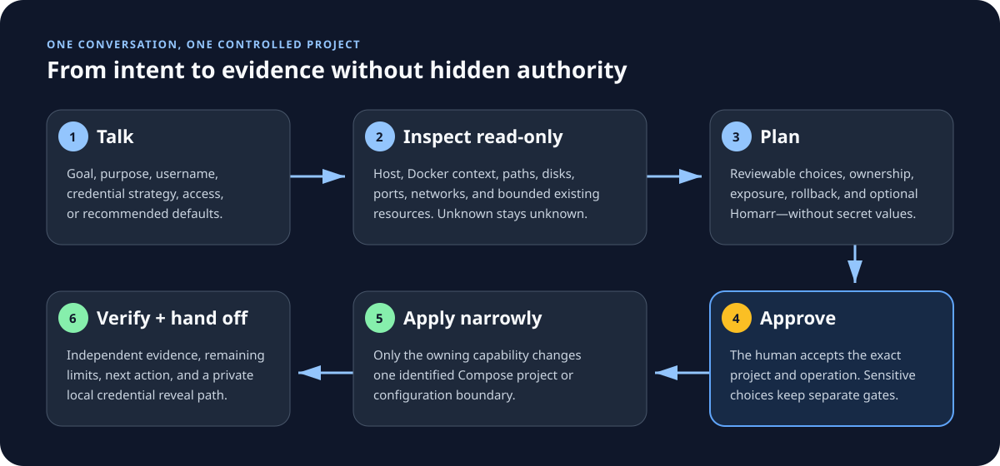
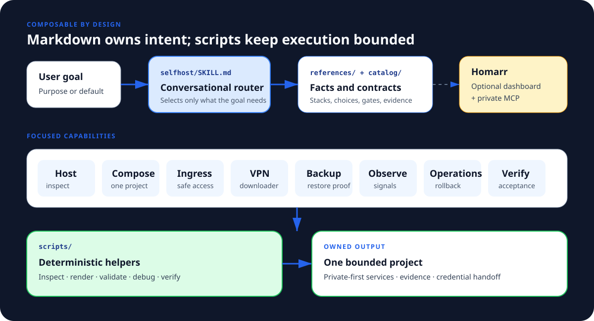

# Self-host

Own your photos, media, files, and passwords instead of depending on another
subscription. Tell your coding agent what you want; it helps choose, install,
connect, and verify self-hosted apps. **Homarr** is the recommended dashboard
and agent front door, not a requirement for every goal.

## Install without cloning this repo

From the project that should own your stack, run this one command (Git and Bun
1.4+ required; authenticate to GitHub first if this repository is private):

```bash
bunx --bun skills@latest add ajnart/selfhost-skills --skill self-host --agent codex --copy --yes
```

Then ask Codex: `$self-host photos`, `$self-host Netflix`, or just `$self-host`.
Add `--global` to install for all projects. For Claude Code, replace
`--agent codex` with `--agent claude-code` and invoke `/self-host`; other
clients are listed [below](#skills-cli-alternative). The installed copy
contains the workflows, catalog, scripts, and media harness. It does not use
this source checkout at runtime. Installing the skill does not deploy apps.



The agent asks only for choices that change your setup. “Defaults” means a
recommended private setup, username `admin` for the managed media stack, and a
generated password. You can choose another username or a supported private
credential source. The agent never asks you to paste a password into chat;
deployment still waits for your approval of the exact plan.

## Tell it what you want to replace

You don't need to know the software names. Start with a familiar service.
These examples use the Pi/OpenCode `/self-host` command; see the client table
below for Codex syntax.

```text
/self-host I want to replace Google Photos and Google Drive
/self-host Netflix
/self-host password manager
/self-host Google Drive, Microsoft OneDrive, Dropbox
/self-host smart speaker
/self-host audio books and music
```

| Your goal | Suggested apps | What they do |
| --- | --- | --- |
| Photos and cloud storage | **Immich + Nextcloud** | Back up and browse photos; sync and share files. |
| Your own movie library | **Jellyfin** | Watch movies and shows you own on your TV, phone or browser. |
| Music and audiobooks | **Navidrome + Audiobookshelf** | Stream your own music and audiobook collection, plus podcasts. |
| A private password manager | **Vaultwarden** | Use compatible Bitwarden apps; set up HTTPS and recovery before importing passwords. |
| Household budgeting | **Actual Budget** or **Firefly III** | Track budgets, accounts and spending. |
| Smart-home control, optional voice and cameras | **Home Assistant**, optionally **Scrypted** | Connect compatible devices, automations and camera systems. |
| Files, office work or notes | **Nextcloud**, with tools chosen for your needs | Share files and add document collaboration when needed; evaluate local note apps separately. |

**Homarr** gives you one place to open apps, see connected services, and use
its read-only MCP integration from a coding agent. Setup checks the
available integrations and widgets; a shortcut alone isn't a tested integration.
Moving existing data and setting up a separate backup are planned before switching.
The managed seven-service media recipe currently includes Homarr and uses
`ghcr.io/homarr-labs/homarr-test:v2`. Other plans may omit Homarr when you ask.

Caddy is an optional way to give apps friendly HTTPS addresses. Setup reuses an
existing proxy where possible and keeps access private unless you choose
otherwise. Network access settings determine who can reach the apps; HTTPS
protects traffic; each app still needs appropriate login and
access controls. Voice assistants need suitable hardware, and media apps need
your own content: these apps don't include a Netflix or Spotify subscription
catalog. Savings depend on the subscriptions you can cancel and the cost of
hardware, hosting, electricity and backups.

The agent explains these choices briefly, then guides setup. See the
[service selection guide](.agents/skills/self-host/references/choosing-services.md)
for the replacement boundaries. Catalog coverage remains broader than the
seven-service tested media harness; other setups retain their stated guided
or discovery status until verified.

## Install in Pi

Install the rolling package and update it with Pi:

```bash
pi install git:github.com/ajnart/selfhost-skills
pi update --extensions
```

This registers `/self-host` and `/skill:self-host`. Pin a release tag instead
when stability matters; pinned refs must be advanced explicitly.

## Optional source installer for named commands

Clone this repository, then install into the project where you will invoke it:

```bash
git clone https://github.com/ajnart/selfhost-skills.git /tmp/selfhost-skills
bun /tmp/selfhost-skills/scripts/install.ts --agent pi --agent opencode --scope project --project-root /path/to/your/project
```

This installs the skill and registers `/self-host` for Pi and OpenCode. The
single Skills CLI command above is enough for normal skill use; clone only if
you want this command adapter. For Codex, use `--agent codex`; invoke
`$self-host` or select it with `/skills`. Codex has no supported project slash command. To install globally,
use `--scope global` and omit `--project-root`. Add `--codex-prompt` only if you
want Codex's deprecated global `/prompts:self-host` bridge.

The installer copies the complete skill, checks for command name collisions,
and updates only its own command files. Run it again to update. See
[installation and migration](.agents/install.md) for removal and other clients.

## Skills CLI alternative

Install Git and Bun 1.4.0 or newer, including `bunx`. From your project:

```bash
bunx --bun skills@latest add ajnart/selfhost-skills --skill self-host
```

Choose your agent and project/global scope in the installer. There is only
**one skill** to select. All internal workflows, catalog data, scripts, and
service recipes travel with it; installing them does not deploy their services.

To install globally for Codex, Claude Code, OpenCode, Pi, OpenClaw, and Hermes:

```bash
bunx --bun skills@latest add ajnart/selfhost-skills --skill self-host --agent codex --agent claude-code --agent opencode --agent pi --agent openclaw --agent hermes-agent --global --copy --yes
```

If Codex was included in a direct global Skills CLI install, this also
registers named commands for the selected clients:

```bash
bun ~/.codex/skills/self-host/scripts/install-command.ts --agent codex --agent pi --agent opencode --scope global
```

For a Pi- or OpenCode-only install, run `install-command.ts` from that client's
installed `self-host` skill directory instead of the Codex path; see
[installation and migration](.agents/install.md). The repository installer
above performs command registration automatically.

Use only the `--agent` flags you need. Omit `--global` for a project install;
omit `--copy` for the installer's normal symlink layout. `--all` targets every
supported agent, which is usually unnecessary. Other Agent Skills clients can
copy the whole `.agents/skills/self-host/` directory into their own skill folder.
See [installation and migration](.agents/install.md) for paths and older installs;
the [OpenCode install guide](docs/opencode-install.md) includes a discovery check.

For native package routes, the versioned release provides a Claude Code plugin
marketplace and a Codex marketplace on the `plugin-claude` and `plugin-codex`
Git refs. Pi can install the source repository as a Git package. OpenCode uses
its Agent Skills loader; it does not need a JS plugin for this workflow. See
[the install guide](.agents/install.md) for client commands and
[the release gate](docs/release.md) for publication checks.

| Agent | Start a conversation |
| --- | --- |
| Codex CLI / IDE | `$self-host photos` or `/skills`; optional deprecated global `/prompts:self-host photos` |
| Claude Code | `/self-host photos` |
| Pi | `/self-host photos` after command setup; `/skill:self-host photos` without it |
| OpenClaw | `/skill self-host photos` |
| Hermes | `/self-host photos` |
| OpenCode | `/self-host photos` after command setup |
| Other clients | Ask to use the `self-host` skill or select it in the client |

Use the same entry point to plan, install, resume, add services, update, or
repair. `/self-host full` selects the supported household recipe; it does not
install every catalog app. The agent loads only the workflow and app references
needed for your request. Codex's custom prompts are deprecated and use the
`/prompts:` prefix; its supported shared entry remains the skill.

Example exchange (illustrative, not a deployment log):

```text
You: $self-host personal media
Agent: Jellyfin plays your library; Seerr handles requests. Homarr is the
       optional dashboard.
       Recommended: private home-network access, username admin, generated
       password. Use defaults, or tell me what to change?
You: Defaults; use /srv/media and username alex.
Agent: [inspects host] Here is the exact project, storage, access, and
       verification plan. No host changes yet. Approve this apply?
You: Approve the proposed apply.
Agent: [applies and verifies] Reports working links, checks, artifact paths,
       and remaining gaps. Secrets stay in private files.
```

## What setup does

1. Ask what you want to do, then recommend apps with a one-line purpose for
   each. Accept `defaults`, or ask one short question when a choice matters:
   people/devices, storage, access, username, or credential policy.
2. Inspect the host and show a concrete plan before making changes.
3. Check prerequisites and install the official `agent-browser` tooling when
   needed. Apply only the approved Compose projects.
4. Configure apps with run-scoped API scripts; use the browser only for failed
   paths or requested visual proof. Save keys privately and let Homarr's
   onboarding generate connected apps and widgets where supported.
5. Verify the selected services and return links, what each service does,
   locations, credential-handoff path, and remaining gaps.



The public [`SKILL.md`](.agents/skills/self-host/SKILL.md) routes the request.
Focused Markdown guides own setup, upkeep, networking, backups, media, and
Homarr. Catalog records describe apps and dependencies; scripts perform
repeatable host inspection, Compose operations, API setup, and verification.
The agent loads only the guides for your goal. Adding an app usually means a
catalog record; a special workflow is needed only when its setup cannot be
described by shared capabilities. See the [workflow index](SKILL_INDEX.md) and
[contributor guide](CONTRIBUTING.md).

The public entry stays short and routes into focused guides, following the
composable style of [mattpocock/skills](https://github.com/mattpocock/skills).
The [media setup reference](.agents/skills/self-host/workflows/selfhost-media/assets/harness/docs/headless-setup.md) lists the exact local API
sequence and private cookie handling behind the repeatable commands.

For example, in the managed media pack, Jellyfin plays your library, Seerr
takes requests, Sonarr and Radarr organize shows and movies, Prowlarr connects
an authorized indexer, and qBittorrent downloads through the configured route.
Homarr can show those services, but a dashboard tile, a saved integration, and
a working widget are three different verification claims. The agent reports
each separately. No media or indexer source is selected for you.

Homarr runs with `ghcr.io/homarr-labs/homarr-test:v2` for now. App shortcuts,
working integrations, and working widgets are checked separately. The default
MCP bridge is read-only; explicitly approved `integration_request` policies can
allow bounded actions for selected integrations, paths, and methods.

The catalog contains 111 apps across 20 goal stacks. Catalog presence is not a
promise of automatic setup: each app keeps its managed, guided, or discovery
support level. Household recipes and Caddy configuration still require real
application and access verification before a run can claim completion.

## Open it from the right device

Setup asks whether you want access on this computer, on your home network, or
away from home. A localhost link on your laptop cannot open a remote server.

`127.0.0.1` in Compose keeps a published port on the server itself. It is useful
for local automation and host-based proxies. For normal home-network use, the
agent plans a reachable LAN or private-tailnet entry point. With containerized
Caddy, upstream traffic uses Docker service names on a shared network; backend
ports need not be published for proxy traffic. Removing the bind address makes
Docker publish on all host interfaces, so it is an access choice, not a cleanup.

Caddy can provide friendly HTTPS names, but DNS, certificate trust, and app
logins must also work on your device. Read [access choices](.agents/skills/self-host/references/access.md)
or the [media headless guide](docs/headless-access.md).

## Credentials and resuming

The agent confirms a username (`admin` if you choose defaults) and generates
passwords through the owning helper. If you prefer a custom password, choose
a supported private entry method; do not paste it into the chat.
Existing passwords and API keys stay out of chat, commands, screenshots, and
ordinary reports. When requested, the private handoff is a mode-0600
`private-handoff.json` containing available credentials, URLs, and storage paths.
The separate report contains no credentials. A partial export remains marked
partial; generating a password does not mean its account has been created.

Return to the same project and invoke `self-host` again. Non-secret choices and
progress live in `.selfhost/preferences.json`, `.selfhost/project.json`, and
`.selfhost/stack.json`. The media adapter retains wiring keys in its private,
password-free `connections.env`. Upkeep checks real host state before resuming
and re-exports credentials only when requested.

Ask `$self-host status` to see what is actually running, `$self-host verify` to
recheck connections, or `$self-host repair` to diagnose a failure. For a managed
media run, the installed harness also exposes scoped `session status RUN_ID`,
`session doctor RUN_ID`, and `session up RUN_ID` through
`selfhost-media/scripts/media-runtime.ts`; the agent will resolve the installed
path and exact run ID from this project. It never needs the source repo.

To restart one already-created media run from the project where you installed
the skill (replace `RUN_ID` with that run's identifier):

```bash
bun .agents/skills/self-host/workflows/selfhost-media/scripts/media-runtime.ts exec -- session up RUN_ID
```

This starts only that run's Compose project; it does not recreate accounts or
change another stack. Use `session status RUN_ID` through the same runtime to
check containers and `session doctor RUN_ID` for diagnostics.

## One skill, on-demand workflows

```text
.agents/skills/self-host/
├── SKILL.md             # Small public entry point
├── commands/            # Optional client slash-command template
├── scripts/             # Optional command installer
├── references/          # Service and access explanations
└── workflows/
    ├── selfhost/        # Planning and searchable catalog
    ├── selfhost-setup/  # New installations and continuation metadata
    ├── selfhost-upkeep/ # Maintenance and recovery
    └── selfhost-*/      # GUIDE.md, scripts, references, optional assets
```

Internal `GUIDE.md` files are documentation, not separately discoverable skills.
Their stable IDs remain in plans and saved records so existing stacks can
resume. Scope and approval boundaries still apply when all files are in one
package. No runtime helper depends on a later repository checkout.

The release ZIP follows [Agent Plugins 1.0](https://agent-plugins.org/specification)
with one `skills/self-host/SKILL.md`, plus Claude Code compatibility metadata.
The source repository's `CLAUDE.md` symlink points to `AGENTS.md` for
contributors. That alias is not part of the release ZIP or needed by the
installed skill.

## Develop and inspect

```bash
bun run stack profiles
bun run selfhost catalog search photos
bun scripts/validate-repo.ts --json
bun scripts/skillpack.ts validate --scope all
```

Root `PROMPT.md`, `docker-compose.yml`, `prompts/`, and harness scripts are the
canonical media harness. After changing them, regenerate the bundled copy with
`bun scripts/refresh-media-bundle.ts`. Never edit only the generated bundle.

- [Workflow index](SKILL_INDEX.md)
- [Invocation](.agents/invocation.md) and [installation](.agents/install.md)
- [Seven-repository command comparison](research/skill-command-comparison-2026-09-24.md)
- [Domain and safety boundaries](.agents/CONTEXT.md)
- [Contribution rules](CONTRIBUTING.md) and [release checks](docs/release.md)

Public exposure, destructive work, backup restores, and downloader VPN routing
have their own plans and evidence requirements. No broad Docker cleanup or
unowned resource changes are part of setup.
