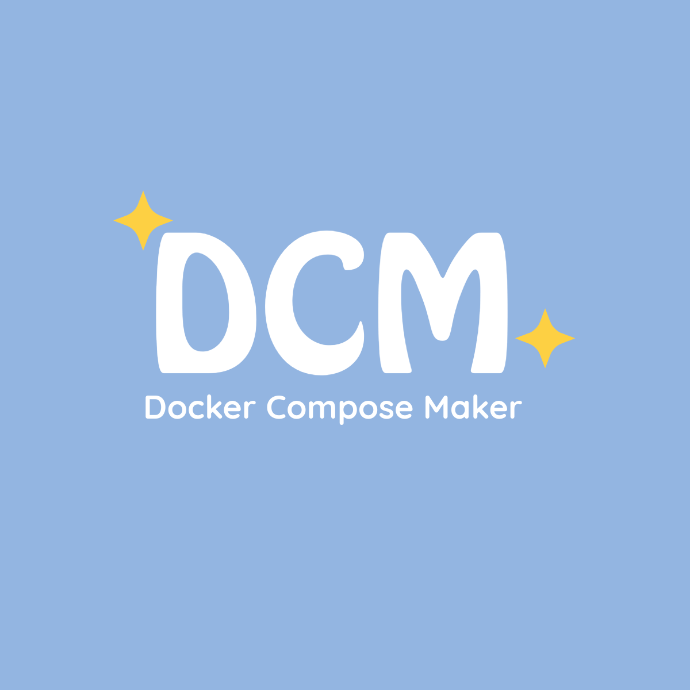
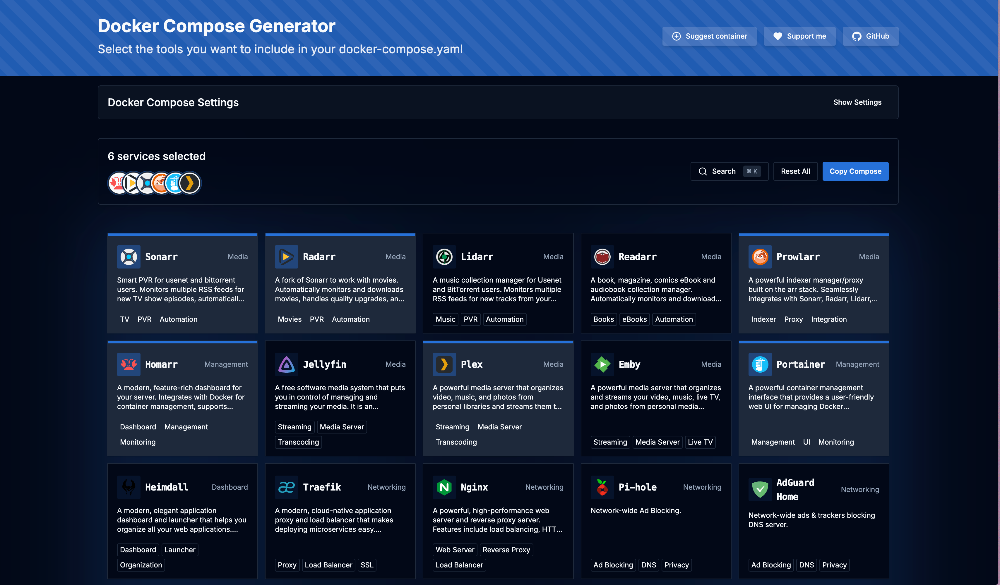
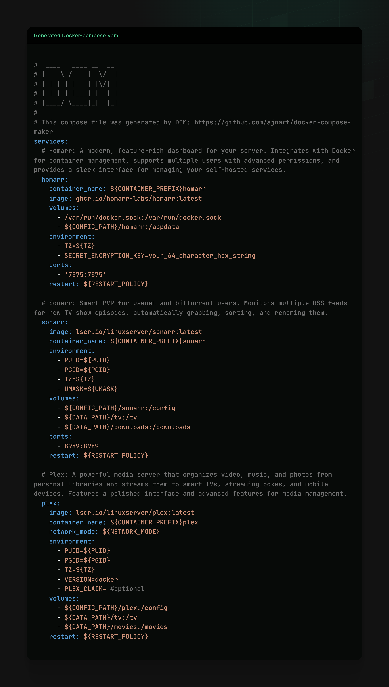

<div align="center">
  
  <h3>DCM - Docker Compose Maker</h3>
</div>

<p align="center">

<a href="https://github.com/ajnart/self-host/actions/workflows/dcm-image.yml">
  
</a>
<a href="https://github.com/ajnart/self-host/pkgs/container/dcm">
  
</a>
</p>

<!-- Links -->
<p align="center">
  <a href="https://self-host.fyi/compose/">
    <strong>Live Demo 🚀</strong>
  </a>
  •
  <a href="#-quick-start">
    <strong>Install 💻</strong>
  </a>
  •
  <a href="#-contributing">
    <strong>Contribute 🤝</strong>
  </a>
  •
  <a href="#-supported-tools">
    <strong>Supported Tools 📦</strong>
  </a>
  •
  <a href="#-screenshots">
    <strong>Screenshots 📸</strong>
  </a>
</p>

## 📋 About

> [!NOTE]
> 🌟 **Community-Driven Project**: DCM started as a simple tool but aims to become the go-to resource for Docker Compose configurations, powered by the community. We believe everyone has their favorite self-hosted tools, and we'd love for you to share yours! Whether you're using a popular application or a hidden gem, your contribution helps others discover and easily deploy great software.

DCM (Docker Compose Maker) turns a handful of clicks into a ready-to-use `docker-compose.yaml` and `.env` for your self-hosted apps. It lives in the [self-host repository](https://github.com/ajnart/self-host) under `dcm/` and is served at [self-host.fyi/compose](https://self-host.fyi/compose/).

DCM has two modes. **self-host** (the default) lists the Apps of the self-host Catalog, each with a standalone compose generated from the Go code in `internal/apps/`. **All** adds the containers only DCM defines, in `dcm/src/tools/`.

Every selection shows the matching `self-host install <apps>` command. [self-host](https://self-host.fyi/?ref=dcm) is one Go binary that installs and wires these apps for you, for people and for AI agents. Rather not manage YAML? Use it. Prefer to own the YAML? DCM stays fully usable on its own.

> [!TIP]
> Most containers come pre-configured with best practices and sensible defaults, saving you hours of documentation reading and configuration tweaking.

> 💡 **Share Your Stack**: Using a great tool that's not listed here? We'd love to include it! Check out our [contribution guide](CONTRIBUTING.md) to help others discover and use your favorite containers.

## 🔧 How to Use DCM

Using Docker Compose Maker is simple and intuitive:

1. **Select containers** - Browse the curated list of self-hosted applications and click to select the ones you want to include
2. **Use templates** - Choose from predefined templates in the Template Gallery for common stacks like media servers
3. **Configure settings** - Adjust environment variables, paths, and other common settings
4. **Generate your configuration** - Click "Copy Compose" to view and customize your docker-compose.yaml
5. **Deploy your stack** - Use one of the following methods to deploy your containers:

> [!IMPORTANT]
> All containers are configured to use environment variables like `${PUID}`, `${PGID}`, and `${TZ}`. Make sure to set these in your deployment to avoid permission issues.

### Deployment Options

Once you have your docker-compose configuration, you have several ways to deploy it:

#### Copy & Paste

Simply copy the generated docker-compose.yaml and .env content, save them locally, and run `docker-compose up -d` to start your containers.

#### Download Files

Download the generated docker-compose.yaml and .env files directly from the interface, then use them with your preferred Docker management tool.

> [!NOTE]
> The downloaded .env file contains all the environment variables referenced in your docker-compose.yaml. Keep both files in the same directory when deploying.

#### Portainer Stacks

If you're already using [Portainer](https://github.com/portainer/portainer) to manage your Docker environment, you can easily deploy your configuration as a stack:

1. Navigate to your Portainer dashboard and select **Stacks** from the sidebar
2. Click **Add stack**
3. Give your stack a name
4. Select **Web editor** and paste the generated docker-compose content
5. (Optional) Add the environment variables from the .env file
6. Click **Deploy the stack**

> [!CAUTION]
> When using Portainer Stacks, you'll need to manually add the environment variables or upload the .env file, as Portainer doesn't automatically read the .env file in all configurations.

Using Portainer provides a user-friendly web interface to manage, update, and monitor your containers without needing command-line tools.

#### Other Docker Management Tools

The generated compose file works with any tool that supports docker-compose syntax, such as Docker Desktop, Rancher, Yacht, or command-line tools.

## 🚀 Quick Start

If you want to try DCM for yourself, there are several ways to get started:

### 🌐 Use the Online Version

Visit [self-host.fyi/compose](https://self-host.fyi/compose/) to use the tool immediately without installation. The old `compose.ajnart.dev` address redirects there.

### 🐳 Run with Docker

Run with a single command:

```bash
docker run -p 7576:7576 --name dcm --rm ghcr.io/ajnart/dcm
```

Then visit `http://localhost:7576` in your browser.

The Docker image is available for multiple platforms:

- linux/amd64
- linux/arm64
- linux/arm/v7

### 📦 Using Docker Compose

Create a `docker-compose.yaml` file:

```yaml
services:
  dcm:
    image: ghcr.io/ajnart/dcm
    container_name: dcm
    ports:
      - "7576:7576"
    restart: unless-stopped
```

Then run:

```bash
docker-compose up -d
```

### 🚀 Using Easypanel

[Easypanel](https://easypanel.io) is a self-hosted Docker deployment platform. It has a one-click Easypanel template for DCM, which runs the image above.

[](https://easypanel.io/templates/dcm)

### 🛠️ Build from Source

1. Clone the repository:

```bash
git clone https://github.com/ajnart/self-host.git
cd self-host
```

2. Install dependencies:

First install [Bun](https://bun.sh/) if you haven't already, then run from the repository root (`dcm/` and `site/` share one bun workspace):

```bash
bun install
```

> [!WARNING]
> Using npm instead of Bun may result in longer installation times and potential compatibility issues. We strongly recommend using Bun for development.

3. Build and start:

```bash
bun run dev
```

From the repository root this starts the self-host site, which also serves DCM, at http://localhost:4321: the home page at `/` and DCM at http://localhost:4321/compose. Edits under `dcm/src` hot-reload there.

DCM has no Astro app of its own: its pages are `site/src/pages/compose/`, and `bun run build` in `site/` writes the whole static site, DCM included, to `site/dist/`. `bun run preview` in `site/` serves it. Every link, asset and API call lives under the fixed `/compose` prefix (`dcm/src/lib/routes.ts`).

#### Self-host catalog and mode toggle

The home page and the template gallery have a segmented control: **self-host** shows only the Apps from the self-host catalog (plus its Recipes as templates) with a `self-host install <apps>` command front and centre, and **All** shows every DCM container with the self-host ones badged. The choice is stored in `localStorage` (`dcm-mode`) and mirrored in the `?mode=` URL parameter. Selection is shared between both modes.

### Community upvotes on Cloudflare Pages

The gallery supports anonymous community upvotes through Pages Functions and Workers KV. No accounts, traditional database, or application server are required. Docker, `bun run dev`, and other static hosts remain fully usable without an API: the upvote control is hidden rather than showing invented counts. Nothing contacts the public DCM instance.

Voting is opt-in: it stays disabled until both bindings below exist on the `self-host-fyi` Pages project.

1. Create a Workers KV namespace for votes in your Cloudflare account and bind it as `UPVOTES`. Use a separate namespace for preview deployments so previews cannot change production votes.
2. Add an encrypted runtime secret named `VOTE_IP_SECRET`, independently for production and preview. Generate a random value of at least 32 bytes and keep it stable. Never commit the secret.
3. Deploy from the repository root: `bash scripts/publish-site.sh X.Y.Z` builds the site and runs `wrangler pages deploy`, which includes the root `functions/` alongside the static output. `functions/compose/api/` re-exports `dcm/functions/api/{vote,stats}.ts` at `/compose/api/*`, and the site's `_routes.json` limits Function invocation to `/compose/api/*`, leaving the pages and assets static. See `docs/releasing.md`.

For local-only development, build the site and serve it through Wrangler with a local KV store, from the repository root:

```bash
SELF_HOST_SITE_VERSION=0.0.0 bash scripts/build-site-pages.sh
bunx wrangler pages dev site/dist-pages --kv=UPVOTES --binding VOTE_IP_SECRET=local-development-only
```

Wrangler uses local KV storage by default; this does not create or deploy cloud resources. Test the API and gallery through Wrangler's URL, not `astro dev`, which serves no Functions. API calls without Cloudflare's `CF-Connecting-IP` header cannot vote. For manual local requests, provide a test IP in that header and an `Origin` matching the local URL. `GET /compose/api/stats` is cached for 60 seconds, so a count lags a vote by up to a minute.

#### API and storage

- `GET /compose/api/stats` returns `{ "counts": { "jellyfin": 0, ... } }` for the current merged catalog, including the Apps taken from self-host. One gallery request loads all counts. Responses are cached for 60 seconds in the browser and per Cloudflare edge location; query strings do not bypass the edge cache.
- `POST /compose/api/vote` accepts `{ "containerId": "jellyfin" }` as JSON, with a same-origin `Origin` header and a body of at most 1 KiB. IDs must exist in the same catalog used by the gallery. It returns `{ "accepted": true }`, or `{ "accepted": false }` if that network has already voted for the container. Votes cannot be removed.
- Each vote writes `vote:{containerId}:{HMAC}`. HMAC-SHA-256 uses the server secret, container ID, and Cloudflare-provided IP. Raw IPs are not stored, sent back, or logged by voting code. A separate `rate:{HMAC}` key expires after 60 seconds and limits new votes across containers from the same IP; rejected votes return `429` with `Retry-After`. Changing forwarded-IP headers does not select the voting identity.
- Browser storage remembers successful votes only as a UX hint; clearing it does not bypass server deduplication. Failed writes do not show a successful vote. Missing bindings, unavailable KV, or exhausted quotas return `503`, without breaking compose generation.

#### Limitations and costs

KV has no atomic increments or transactions. Counting durable, deterministic ballot keys avoids losing distinct votes during concurrent counter updates, and repeated writes for the same IP/container still count once. However, KV reads and listings are eventually consistent: counts can lag by 60 seconds or more, plus the response cache. The UI increments after acknowledgement, so a refreshed page can temporarily show an older count. Parallel reads can miss a recent ballot or throttle marker; the throttle is best-effort, not a strict abuse-prevention boundary. A failed ballot write after the throttle write can require waiting 60 seconds before retrying.

This is a community signal, not verified ratings or a guarantee that a container works. Shared public IPs share a vote; changing IP/VPN can evade deduplication. Rotating `VOTE_IP_SECRET` permits new votes from previously seen networks, while existing votes remain counted. Ballots do not expire and contain pseudonymous identifiers; restrict namespace access and consider your privacy/retention obligations.

An accepted vote normally uses two KV reads and two writes. A cold stats response lists every ballot in pages of 1,000, with no per-ballot reads; costs grow with total votes and active edge locations. The API fails unavailable rather than returning partial counts if listing exceeds 50 pages (about 50,000 ballots). Monitor KV **list**, read, write, storage, and Pages Functions quotas: free-tier operation is not guaranteed, and listing quotas can be reached before read quotas. For higher traffic or strict throttling/count consistency, move aggregation and coordination to a Durable Object rather than adding non-atomic counters.

Cloudflare references: [Pages bindings and secrets](https://developers.cloudflare.com/pages/functions/bindings/), [Wrangler Pages configuration](https://developers.cloudflare.com/pages/functions/wrangler-configuration/), [KV listing and pagination](https://developers.cloudflare.com/kv/api/list-keys/), and [KV consistency](https://developers.cloudflare.com/kv/concepts/how-kv-works/).

## 🧰 Supported Tools

DCM includes configuration for many popular self-hosted applications, including:

📺 **Media Management**:

- **Media Servers**: [Jellyfin](https://github.com/jellyfin/jellyfin), [Plex](https://github.com/plexinc/pms-docker), [Emby](https://github.com/MediaBrowser/Emby)
- **Media Automation**: [Sonarr](https://github.com/Sonarr/Sonarr), [Radarr](https://github.com/Radarr/Radarr), [Lidarr](https://github.com/lidarr/Lidarr), [Readarr](https://github.com/Readarr/Readarr), [Prowlarr](https://github.com/Prowlarr/Prowlarr), [Bazarr](https://github.com/morpheus65535/bazarr), [Whisparr](https://github.com/whisparr/whisparr)
- **Media Requests**: [Jellyseerr](https://github.com/Fallenbagel/jellyseerr), [Overseerr](https://github.com/sct/overseerr), [Doplarr](https://github.com/kiranshila/Doplarr), [Requestrr](https://github.com/darkalfx/requestrr)

🔍 **Dashboards & Management**:

- **Dashboards**: [Homarr](https://github.com/homarr-labs/homarr), [Heimdall](https://github.com/linuxserver/Heimdall)
- **Container Management**: [Portainer](https://github.com/portainer/portainer)
- **Media Analytics**: [Tautulli](https://github.com/Tautulli/Tautulli)

📥 **Download Management**:

- **Torrent**: [qBittorrent](https://github.com/qbittorrent/qBittorrent)
- **Usenet**: [NZBGet](https://github.com/nzbget/nzbget), [NZBHydra 2](https://github.com/theotherp/nzbhydra2)
- **Indexers**: [Jackett](https://github.com/Jackett/Jackett), [Prowlarr](https://github.com/Prowlarr/Prowlarr)

🗄️ **Databases**:

- **SQL**: [MariaDB](https://github.com/MariaDB/server), [MySQL](https://github.com/mysql/mysql-server), [PostgreSQL](https://github.com/postgres/postgres)
- **NoSQL**: [MongoDB](https://github.com/mongodb/mongo), [Redis](https://github.com/redis/redis)

📊 **Monitoring & Automation**:

- **Monitoring**: [Grafana](https://github.com/grafana/grafana), [Prometheus](https://github.com/prometheus/prometheus)
- **Updates**: [Watchtower](https://github.com/containrrr/watchtower)
- **Home Automation**: [Home Assistant](https://github.com/home-assistant/core)

🔐 **Security**: [Vaultwarden](https://github.com/dani-garcia/vaultwarden)

💾 **Storage & Files**: [Nextcloud](https://github.com/nextcloud/server)

Each tool includes a detailed description, GitHub star count, and pre-configured docker-compose settings.

## 🎁 Want it installed for you?

> [!NOTE]
> self-host is in preview: public downloads are not available yet, so the install command only works with access to its repository. The in-browser playground works for everyone.

Skip the YAML. [self-host](https://self-host.fyi/?ref=dcm) is one Go binary that installs, wires (API keys, Homarr tiles, download clients) and repairs self-hosted apps with Docker Compose. It has a terminal dashboard for people and `--json` commands for AI agents. DCM links to it from the header, the selection bar and the Copy Compose modal, prefilled with your selected services (`https://self-host.fyi/?apps=<ids>&ref=dcm`).

The self-host catalog is generated into `src/data/selfhost.json` by `go run ./tools/sitegen` at the repository root; do not edit it by hand. The Apps in self-host mode are edited under `internal/apps/`, not here.

## 🧪 Testing

DCM uses [Bun](https://bun.sh/) for testing. To run the tests:

From `dcm/` (or `bun run --cwd dcm <script>` from the repository root):

```bash
# Run all tests
bun test

# Run Docker Compose validation tests (needs Docker)
bun run test:compose

# Run container schema validation tests
bun run test:containers
```

## 🔄 Template Gallery

DCM includes a Template Gallery that allows you to quickly add predefined stacks of containers based on common use cases:

- **Media Server Stacks**: Complete media server setups with Jellyfin/Plex and related tools
- **Development Environments**: Web development stacks with databases and web servers
- **Monitoring Solutions**: Grafana, Prometheus, and other monitoring tools
- **Database Clusters**: Various database engines with management tools
- **Security Tools**: Password managers and security-related containers
- **And more!**: Smart home hubs, personal cloud solutions, and other useful templates

To use the Template Gallery:

1. Click the "Template Gallery" button at the top of the main page
2. Browse or search for templates that match your needs
3. Click "Use Template" to add all containers from that template to your selection
4. Return to the main page to customize your selected containers

You can combine multiple templates to create your perfect self-hosted environment!

## 🖼️ Screenshots

### User Interface



### Generated docker compose file



## 🤝 Contributing

We welcome contributions to DCM! Whether you want to add new container definitions, improve documentation, or fix bugs, your help is appreciated. Open issues and pull requests in [ajnart/self-host](https://github.com/ajnart/self-host).

Please check our [CONTRIBUTING.md](CONTRIBUTING.md) guide for detailed instructions on:

- How to add new container definitions (`dcm/src/tools/`)
- Code style guidelines
- Testing requirements
- Pull request process

The easiest way to contribute is by adding new container definitions to our growing collection!

## 📜 License

This project is licensed under the GNU Affero General Public License v3.0 only (AGPL-3.0-only) - see the [LICENSE](LICENSE) file for details.

## 💖 Support

If you find this tool useful, consider supporting the project by:

- ⭐ Starring the repository on GitHub
- 🐦 Sharing it on social media
- ☕ [Buying me a coffee](https://ko-fi.com/ajnart)

## 📞 Contact

- GitHub: [@ajnart](https://github.com/ajnart)

---

Made with ❤️ by [ajnart](https://github.com/ajnart)
