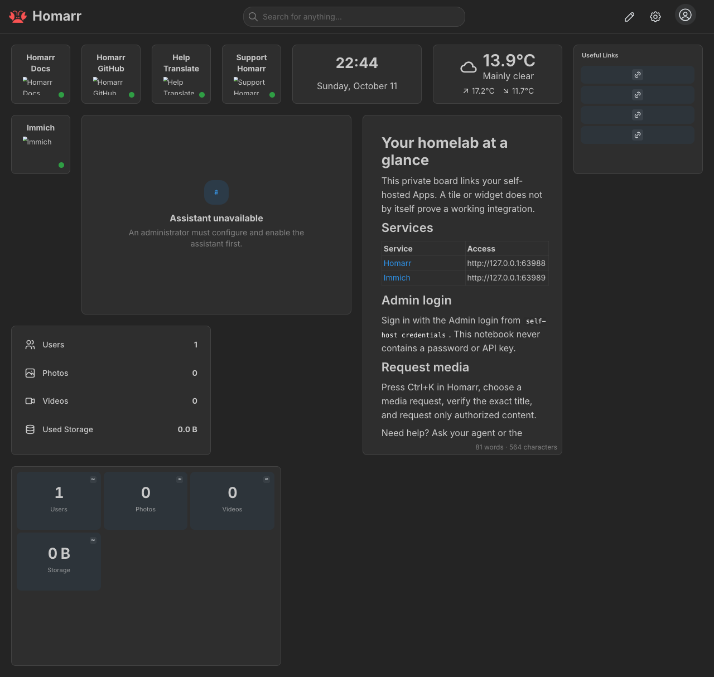

# Immich native Homarr proof

Real-container, authenticated API and isolated browser acceptance passed on
**11 October 2026** at source
`dce263ef822dc056558a648f8f59ea795a3e56d9`, after reconciling main through
`89981a1653e379ada7390ca543f00576ea7c77b2`. Later evidence-only changes do not
extend that runtime claim to different production code.

This covers [#262](https://github.com/ajnart/selfhost-skills/issues/262) and the
[Homarr Link contract](homarr-integration-contract.md), not other peer Apps.
The final successful runtime record is `sh_12cb512d9001TWJZ6LNtyZtd2N`, using
disposable root `immich-proof-262-1217360912` and loopback ports 63988/63989.

## Containment and method

- Disposable Compose Project and browser namespace: `selfhost-sol-immich-262`.
- Only Homarr and Immich installed, with five containers capped individually at
  1 GiB memory, 1 CPU and 512 PIDs; 15-minute fixture deadline.
- Unique Home, media and downloads folders under the approved temporary root;
  dynamically allocated loopback ports and private Homarr boards.
- `SELF_HOST_NO_TELEMETRY=1`, `DO_NOT_TRACK=1`, development dependencies and
  `GOFLAGS=-buildvcs=false`; Go 1.26.0 on darwin/arm64, containers linux/arm64.
- Install, Setup, remove, reinstall and teardown used the production service
  boundary. The temporary wrapper only added resource caps and captured helpers;
  it forwarded `SecretDeclarer` so required startup secrets were generated.
- Fixtures used helpers for credentials and HTTP; browser login received the
  generated password through stdin, never arguments. No protected files read,
  credentials UI captured, TLS bypass or real user browser session used.
- A Debug report preceded the browser check. A separate agent-browser process
  loaded the private Home board, waited for populated shared Stats, took an
  accessibility snapshot and a full-page screenshot. The screenshot was reviewed
  visually, not inferred from API readback.
- Teardown removed only owned containers/networks and closed the isolated browser.
  Volumes and disposable data were kept; no prune or volume deletion.

The temporary acceptance source is retained outside the repository at
`/private/var/folders/kx/hccbvbyd6sb61s6lrr2jyt2m0000gn/T/opencode/immich-proof-evidence-262-Bi8bGQ/main.go`.
Its SHA-256 is `a97154be3beeabf0064667cdb4530e0639ed25ca3ad667ebaf4c5e8d50095819`.
It is not a shipped command or a CI test. To reproduce, restore it temporarily as
`tools/immich-proof/main.go` at the recorded source, with Docker and agent-browser
available and the same containment approved, then run:

```bash
GOFLAGS=-buildvcs=false SELF_HOST_NO_TELEMETRY=1 DO_NOT_TRACK=1 go run ./tools/immich-proof
```

## Controlled data and results

The library contained no photos or videos and exactly one fixture administrator.
This is authenticated empty-library acceptance, not populated-media acceptance.

| Check                   | Observed result                                                                                                                                               |
| ----------------------- | ------------------------------------------------------------------------------------------------------------------------------------------------------------- |
| Credential Setup        | Dedicated administrator-owned key with exactly `user.read` and `server.statistics`; authenticated identity, key metadata, statistics and user list validated. |
| Native connection       | Authenticated `widget.immich.getServerStats` returned `userCount: 1`, `photoCount: 0`, `videoCount: 0`, `totalLibraryUsageInBytes: 0`.                        |
| Negative authentication | Anonymous and wrong-key statistics requests rejected with 401/403; the scoped key also denied album access.                                                   |
| Rendered data           | Native server-stat widget and shared Stats displayed Users 1, Photos 0, Videos 0 and Storage 0 B; native storage formatted as 0.0 B.                          |
| Rerun                   | Valid key, owned integration ID and recorded widget IDs unchanged.                                                                                            |
| Credential update       | Fixture replaced the key through the administrator API and helpers; Setup updated the same owned integration, preserving widget IDs and correct native data.  |
| User resources          | A matching unowned integration, its Home widget and its entry in shared Stats survived Setup and owned removal.                                               |
| Ordinary removal        | Owned integration removed; user integration/widget/metric preserved; Homarr continued running.                                                                |
| Cross-board reference   | A user widget on another private board retained its referenced integration after Immich removal; recorded Link ownership was cleared.                         |
| Reinstall               | Created a distinct owned integration; the preserved integration still returned the controlled native statistics.                                              |
| Cleanup                 | Production Project teardown succeeded; owned containers and networks removed, data kept.                                                                      |

The preserved integration's linked App record remained present with an empty
description. Its recorded App ID and Link ID were cleared; reinstall created
distinct owned App/integration IDs while the preserved App stayed unmarked and
its integration continued returning correct native statistics.

The successful fixture milestones included:

```text
INSTALL PASSED
ANONYMOUS/WRONG KEY/ALBUM ACCESS DENIED
RERUN STABLE KEY/INTEGRATION PASSED
CREDENTIAL UPDATE STABLE INTEGRATION/WIDGETS PASSED
MATCHING USER INTEGRATION PRESERVED ON RERUN
OWNED REMOVAL/USER INTEGRATION PRESERVATION PASSED
PRESERVED APP MARKER/RECORDED ID RELINQUISHMENT PASSED
CROSS-BOARD PRESERVATION/RELINQUISH/REINSTALL PASSED
FUNCTIONAL PROOF PASSED
OWNED CLEANUP PASSED
```

The stricter fixture initially required an empty string for the released App
description. Pinned Homarr [normalizes it to null](https://github.com/homarr-labs/homarr/blob/ebbd4876d25a51151444a009ab596e1154d62880/packages/validation/src/app.ts).
The corrected fixture accepts only null or an empty string, still rejects a
missing/nonempty description, and passed without changing production code.

## Exact image identities

All resolved images were linux/arm64. Tags remain mutable; these are the locally
resolved RepoDigests and image IDs inspected for the acceptance run.

| Image tag                                                        | RepoDigest SHA-256                                                 | Local image ID SHA-256                                             |
| ---------------------------------------------------------------- | ------------------------------------------------------------------ | ------------------------------------------------------------------ |
| `ghcr.io/homarr-labs/homarr:v2.4.1`                              | `ee67a5e856c051c4e114418a54b89a3fc3cb5507d0689e5cb89c790305c549cd` | `c6d895d659718b05ab9cc7b936458e6f5820b5cf3f0d35318588bd1b6901ee1b` |
| `ghcr.io/immich-app/immich-server:v3.2.2`                        | `79cc1623323d5894922686d8743b4780181428f98eecbfb58ce12c41ef02d1ea` | `164cd74d962e81d75071caf31067749e14a9981e3909d198f261c3919dfaefff` |
| `ghcr.io/immich-app/immich-machine-learning:v3.2.2`              | `60dfcf266a9ef3b7376f5678e8c980d4fb61db5fc48c078fe8a326ab1535d60d` | `8d873c50e77d820ad54908303ee25d67eb8da0e001474dd387c256e11b717b43` |
| `ghcr.io/immich-app/postgres:14-vectorchord0.4.3-pgvectors0.2.0` | `bcf63357191b76a916ae5eb93464d65c07511da41e3bf7a8416db519b40b1c23` | `1e66b73624e79cc926fe821507dd1b610989204e71c55c1335b342a6feada854` |
| `valkey/valkey:9`                                                | `418652cfb58ef879d4978c33553735d7147016032d5aefaa14c828e611eb9dfd` | `f911c6adffb5087242cc7bb39ceb7362fad4bc25bf78be072a8e6a5cfdc72f97` |

The Homarr API/source contract is
`ebbd4876d25a51151444a009ab596e1154d62880`; it is not the container digest.

## Local gate and limits

At the recorded source, build, both vet runs, full Go tests, race checks for
Homarr/Immich/TUI/Activity/service, shell syntax and formatting passed. CI is not
claimed; these were local gates, without the e2e Docker build tag at runtime.

Nonempty media, album/gallery features, lost/rejected-key Manual recovery,
version migration, restore, physical LAN access and other peer Apps
were not exercised. Immich has nil `preflight`: this proves unchanged reference
behavior after adding the seam, not execution of a non-nil Frigate callback or
its trusted-HTTPS prerequisite. That live acceptance remains peer-owned.

The browser allowed only `127.0.0.1`: external App icons were blocked and the
seed weather widget is outside this acceptance scope. The unconfigured assistant
remained unavailable. Neither affects the verified native/shared Immich statistics.

## Reviewed screenshot

`images/immich-homarr-proof.png` SHA-256:
`2668c377207c9cd5c9636c95807bc131bd123d04457bec43cf20816cc0a23ba1`.


