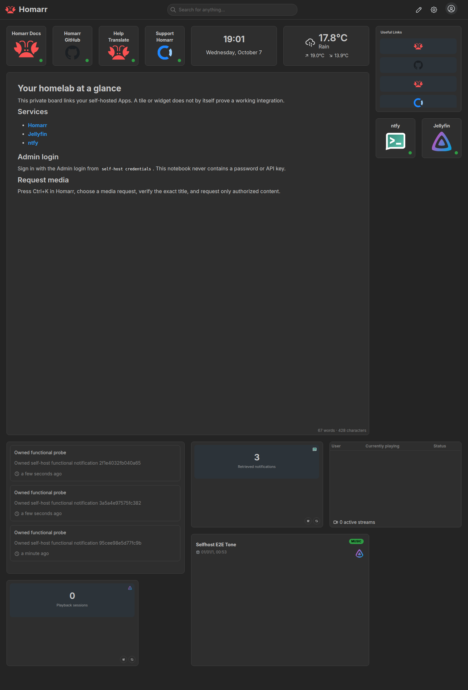
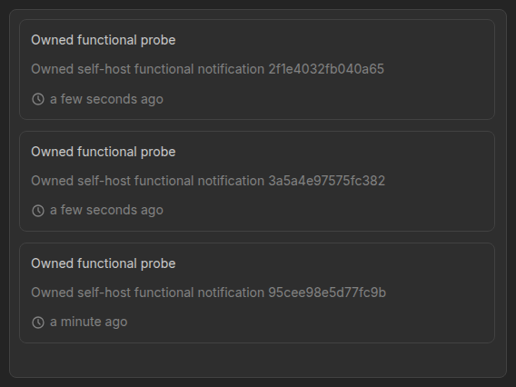
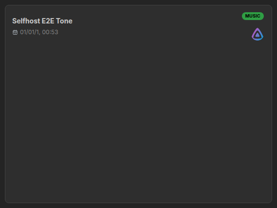
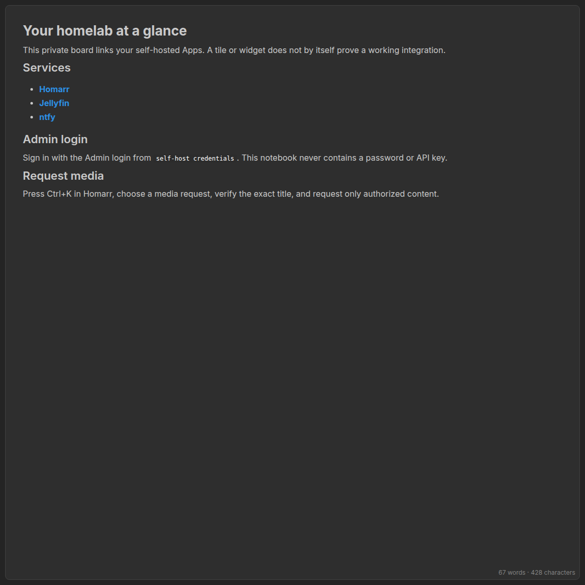

# Homarr functional proof

Nine scoped stages and owned cleanup passed on **7 October 2026**, on Linux/amd64. The dashboard and all three panel screenshots were visually reviewed: populated, unobstructed, readable, and with loaded App icons. This is real-container/API/browser evidence, separate from synthetic fixtures.

Runtime head: `374bd1c813aa6f2d32580f1ae4fe2711a0ecb427`  
CLI binary SHA-256: `4a1329fe447ecffb7e799ba1f385311fb42fc2f95b0e0c25b290976b0be5d6bb`

[Machine-readable proof](homarr-proof.json) records full image identities and SHA-256 checksums for the immutable archive and copied artifacts. Source archive: `/tmp/selfhost-runtime-iterations/homarr-374bd1c`. Every copied PNG matches its archived checksum. Credentials, cookies, raw responses and private runtime stores are excluded.

| Stage | Observed result |
| --- | --- |
| Install | Isolated Homarr, ntfy and Jellyfin configured through headless setup. |
| Administrator board | Admin session read private Home, persisted and reverted a benign title edit; anonymous private reads denied or excluded. |
| Notification roundtrip | Exact published ID/body read back from ntfy and exposed by Homarr; nonzero current message statistics; anonymous topic access denied. |
| Synthetic media release | Jellyfin scanned the owned audio; Homarr returned its exact item/integration IDs. |
| Idempotency/restart | Repeated setup and restart preserved resource identities without duplicates. |
| URL reconciliation | Drift repaired; `LAN_IP=127.0.0.2` preserved loopback binding and resource identities. |
| Credential recovery | Invalid owned ntfy token produced targeted `homarr/link-ntfy` failure, exit 2 and retry hint. Restoring the valid token and retrying recovered notifications without changing unrelated resources. |
| Add/remove | Gatus navigation tile add/remove and ntfy removal/reinstall reconciled tiles, integrations, widgets and notebook; Jellyfin resources and shared admin credentials preserved. |
| Browser dashboard | Real form admin login, normal Skip tour dismissal, readable live widgets/notebook and loaded icons; four screenshots reviewed. |

Home adopts the upstream private seeded board: its creator is not assigned by upstream. This proof establishes administrator access, not transferred creator attribution. Seed bookmarks and user resources remain preserved. App tiles, integration data and visible widgets are separate verified claims.

`Selfhost E2E Tone` is an authorized, locally generated one-second mono 16-bit PCM WAV. The media widget proves catalog/release visibility; playback and streaming were not exercised. The three notification messages are owned acceptance payloads. `127.0.0.2` exercises configuration metadata, **not physical LAN access**. The negative-token test restored its known valid token; it did not exercise the suggested ntfy repair command.

[CI run 37655239987](https://github.com/ajnart/selfhost-skills/actions/runs/37655239987) passed at `374bd1c813aa6f2d32580f1ae4fe2711a0ecb427`. CI and this final API/browser/TUI proof cover the **same immutable head**.

## Actual terminal proof

After **all nine API/browser stages passed**, the fixture paused for a real native PTY capture. The [Dashboard](images/dashboard.png), [Space-expanded Workflow](images/workflow.png) and [Install search](images/install-search.png) were captured read-only and visually reviewed with the four browser PNGs. The fixture then resumed and owned cleanup passed. No Docker logs, credentials UI or mutations were used during terminal capture.

[Terminal recording](demos/self-host.cast) and [capture provenance](demos/capture.json) record the same runtime head and binary. The machine-readable proof includes the checksums of all ten archived evidence files, including all seven images.

## Recorded images

| Service | Linux/amd64 image ID |
| --- | --- |
| homarr | `sha256:0330b79902f792d55c9ac0d9a573ce7ec1d0fc84410df4fc52f9594addb207b8` |
| ntfy | `sha256:2a9ce4a61de215b23367af546f72e2f2a42cd0ba3573408cc0006f7096b4b6f1` |
| jellyfin | `sha256:fbd967af0187a569b0c18d2db6cb311fdf0df4aeb520102c63f19320aadf964d` |

Gatus was a transient add/remove subject, absent from the final dashboard. Cleanup passed for the owned fixture.

## Verified screenshots

